# Mamulengo

**[Try it live](https://zednaked.github.io/mamulengo/)**: six characters animated by the core in your browser; drag them and watch the physics react.

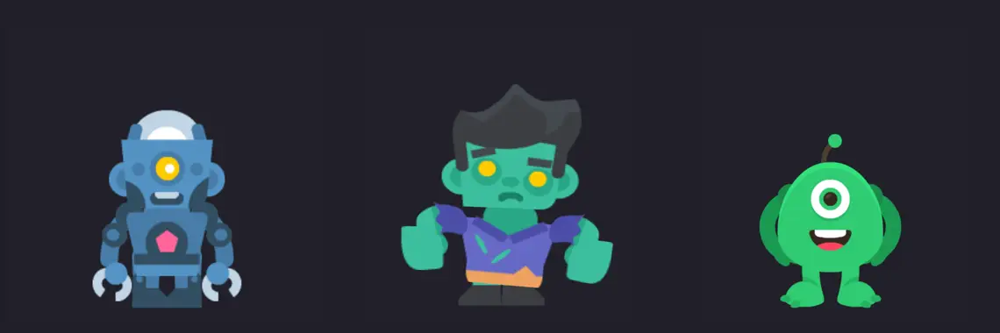

**A 2D skeletal animation toolkit for games, run by people and Claude Code
together.** Rig a character from a layered PSD, animate it on a timeline, or ask
Claude to do it over MCP and watch every bone it moves, live, in the same editor.
Characters are saved as `.boneco`, one readable file that carries its atlas,
transitions and a written brief. A C++ core, written from scratch, plays them in
Godot (engine module or GDExtension) and in the browser (328 KB of WebAssembly, 128 KB gzipped).
It opens and writes Spine 4.3 projects, so nothing already made gets left behind,
and adds what Spine does not have: per-part effects, particles and 2.5D turns.

[Leia em português](README.pt-BR.md) · Godot 4.5+ · Linux, Windows and macOS

```
466 of 466 playback scripts match the reference runtime every frame, events too
20 characters posed in 0.043 ms a frame (native), about 5x faster than the runtime it replaces
102 of 102 production Spine 4.3 projects round-trip through .boneco unchanged
a slot game on staging runs on the core: 1 wasm instead of 3
on a mid-range Android phone, a web game drawn at its base size: 10 dropped frames in 30 s instead of 130 to 180
GPU objects created per frame in that game: 160 before, 0.3 now
```

**On this page:** [what it does](#what-it-does) ·
[beyond Spine](#beyond-spine) · [Claude Code](#working-with-claude-code) ·
[the agent bench](#the-agent-bench) · [the .boneco format](#the-boneco-format) ·
[the core](#the-core) · [use in your Godot game](#use-in-your-godot-game) ·
[in a Godot game](#in-a-godot-game) · [on phones](#on-phones) · [run it](#run-it) ·
[status](#status)

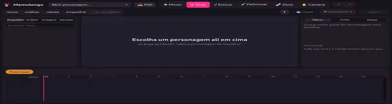

*Claude Code rigging and animating a robot from loose parts, on its own, over
MCP, at 3x speed. Art: Toon Characters by Kenney (CC0).*

A mamulengo is the hand puppet of northeastern Brazil, carved in wood and worked
from below the stage. This one is worked from both sides: an animator with a
mouse and an agent with tools share the same document, the same undo history and
the same rules for what a good animation is.

## What it does

- **From PSD to rig.** Drop a layered `.psd` and it builds the character in the
  PSD's composition, or updates the open one layer by layer, keeping animations,
  meshes and weights. It understands the usual layer tags (`[bone]`, `[slot]`,
  `[skin]`, `[mesh]`...).
- **Animate.** Bones, timeline with draggable keys, curve editor, onion skin,
  events, transitions between animations previewed exactly as the game plays
  them, meshes with painted weights, deform brush, IK, physics, clipping, paths,
  skins. Ready-made motions (breathe, sway, bounce, pop in, shake, blink,
  flipbook) and ready-made physics (hair, ears, cloth, spring, hanging).
- **Every action is a command.** The UI and Claude call the same typed command
  registry, so undo, history and "watch Claude work" come for free.
- **Versions and notes.** Every save is a version you can name, diff and
  restore; anyone can pin notes to an animation, an instant and a part.
- **A brief per character.** `<name>.ficha.md` says what the rig allows and
  what each animation should do, with rules the tool checks: amplitude and
  silhouette against the house median, joint limits after IK, meshes that fold
  too far, hidden edges that show, transitions that jump.
- **Export** a GIF or WebM of any animation or transition, as seen on screen or
  of a fixed crop of the world, optionally framed for sharing (title, timed
  captions, footer). GIFs store only what changed between frames.
- **Reference image.** Lay a drawing or the original art over the character,
  pinned to the world and semi-transparent, to check pose, proportion and fit.
- **Sharper art from vectors.** `tools/atlas-hd.ts` rebuilds an atlas page at 2x,
  3x... from the source SVG, part by part, in the same layout.

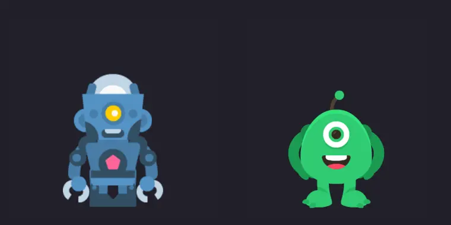

*Win into idle, previewed the way the game blends it.*

Full guide (in Portuguese): [docs/EDITOR.md](docs/EDITOR.md).

## Beyond Spine

Things the `.boneco` format and the core do that Spine does not, keyed on the
timeline like any other property, drawn the same way in the editor, the browser
and Godot (`BonecoSprite`). Exporting to Spine drops them, with a warning.

- **Effects per part:** outline, glow, dissolve (with a grain size and a burning
  edge) and tint. The mesh grows along its contour so the halo has room.
- **Smear:** a part moving fast stretches back toward where it came from and fades
  at the tail, like the smear frames of cartoons, and settles by itself when it
  slows down. It follows what the game really does (mixes, queues, physics), only
  moves vertices and costs next to nothing on the GPU.
- **Particles attached to bones:** sprite emitters with rate and bursts, color
  ramps, additive blend and sway (fire, sparks, smoke); procedural **lightning**
  between two bones; a ring in **orbit** that passes behind and in front of the
  body.
- **2.5D turns:** `deform.turn` turns a mesh like a cylinder, so a head can look
  sideways with the ears staying rigid.

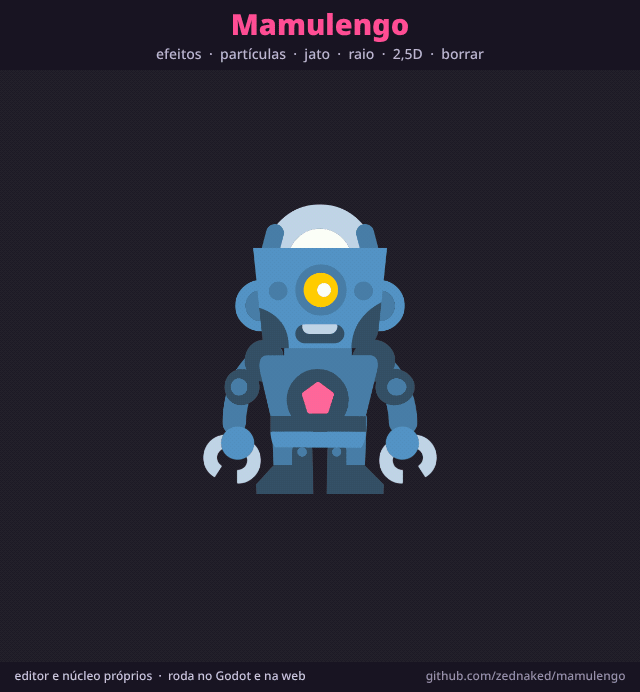

*[exemplos/vitrine](exemplos/vitrine): the CC0 robot going through every feature
in one 8.6 s loop. Exported from the editor, frame and captions included.*

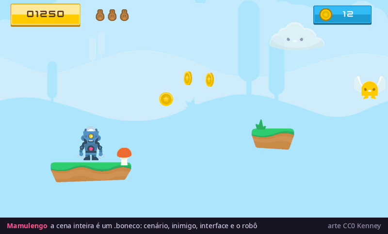

*[exemplos/jogo](exemplos/jogo): a whole game screen in one `.boneco`, with
parallax, platforms, coins, an enemy, a HUD and the robot as the hero. Art: Jumper
Pack, UI Pack and Particle Pack by Kenney (CC0).*

The math and the parameters: [docs/NUCLEO.md](docs/NUCLEO.md) ("Efeitos" and
"Partículas").

## Working with Claude Code

Open Claude Code in this folder and the `mamulengo` MCP server is there
(`.mcp.json`); it starts the editor if it is not running.

| tool | what for |
|---|---|
| `mamulengo_open`, `mamulengo_assets` | find and open a character |
| `mamulengo_run` | run commands in a batch, one undo step, all or nothing |
| `mamulengo_look` | a rendered frame or contact sheet, alone or across a transition |
| `mamulengo_guia` | the workflow: brief, rig, animate, check |
| `mamulengo_notas`, `mamulengo_versoes` | team notes and versions |
| `mamulengo_export` | GIF or WebM, returns the file path |
| `mamulengo_psd` | new character from a PSD, or update the open one |

To work in a window someone is watching, `tools/ponte.ts servir` keeps a fixed
connection to the open editor and relays calls (`chamar`, `olhar`), so every step
shows up there as it happens.

While an agent works, any other tab on the editor follows it: the character, the
animation and the bones it touches light up as it goes, and what it writes between
commands shows up as captions.

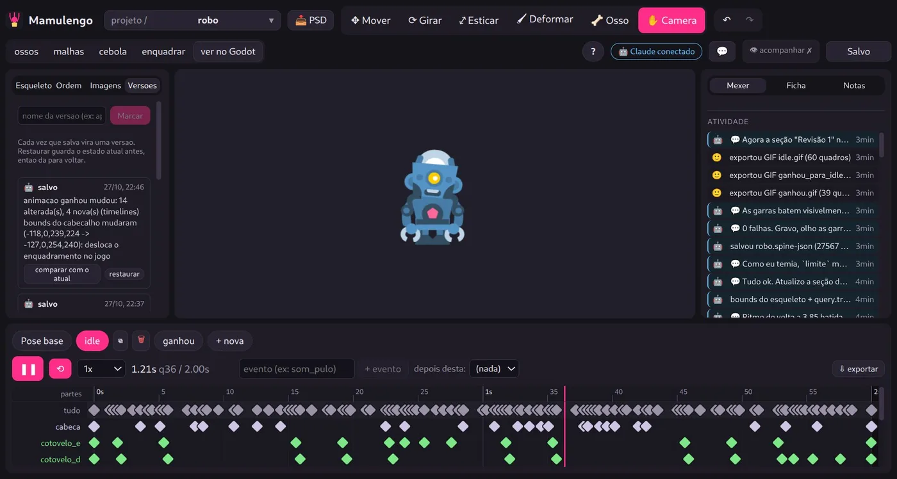

*The editor while Claude works: every save becomes a version (left), every command and
note the agent sends shows up in the activity feed (right).*

What `mamulengo_look` hands back is what the agent judges by, a contact sheet of the
key poses:

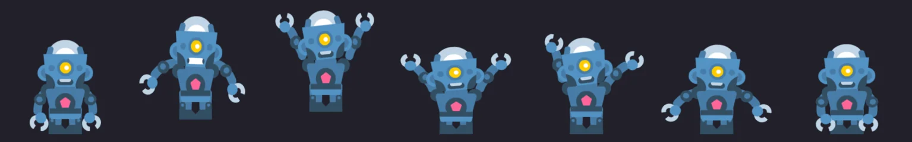

## The agent bench

A headless Claude Code takes a written request and does the rig, the brief and
the animations through MCP only, in an isolated folder. A director agent grades
the result against a rubric and sends it back with notes. The screen can be
recorded, which is where these timelapses come from.

| robot: `ganhou` (win) | zombie: `anda` (walk) | monster: `ganhou` (win) |
|---|---|---|
| 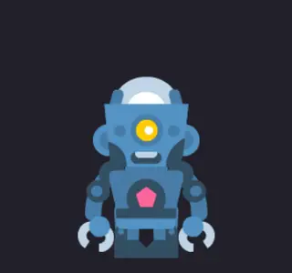 | 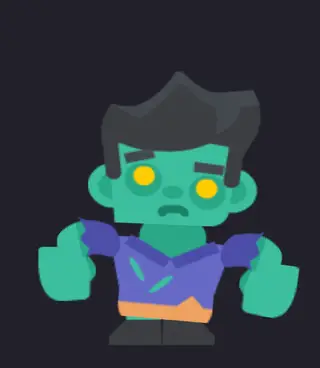 |  |

<details>
<summary>The other two timelapses: the zombie and the monster</summary>

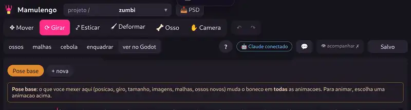

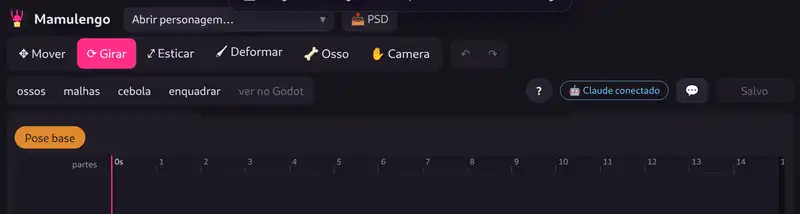

</details>

Art: [Toon Characters](https://kenney.nl/assets/toon-characters-1) and
[Monster Builder Pack](https://kenney.nl/assets/monster-builder-pack), by Kenney
(CC0). Rigs, briefs and animations made by the agent. Guide:
[docs/BANCADA.md](docs/BANCADA.md).

## The .boneco format

One JSON file per character: skeleton, atlas regions, animations, the transition
times the game uses, page compression for the game and the brief. Field names
are in Portuguese and every one of them maps both ways to Spine 4.3, so a
`.boneco` exports back to the exact JSON and atlas it came from (102 of 102
production projects, at a median 1.05x the size). For shipping, the same file can be
stored in binary: about 5 times smaller and 1.6 times faster to load, with the pose byte
for byte the same. Where the two runtimes the
games used disagreed (multiply ignoring alpha, physics gravity flipping sign),
the format says which one it means. Spec: [docs/FORMATO.md](docs/FORMATO.md).

```sh
npx tsx tools/boneco.ts importar <x-data.tres|x.json> <x.boneco>
npx tsx tools/boneco.ts exportar <x.boneco> <folder>
```

## The core

`nucleo/` is C++17 with no dependencies, written clean-room: from a written spec
and from numbers measured on a reference runtime used as a black box, never from
its source. It does poses (bones, curves, slots, regions, weighted meshes,
deform, IK, transform, path and physics constraints), animation state (tracks,
queues, mixing, events) and draw lists (batches by page and blend, clipping on
the GPU stencil or on the CPU).

| measured against the reference runtime | result |
|---|---|
| poses, 78 animations of 20 characters, every frame at 30 fps | worst bone 0.00005 px |
| animation state, 466 scripts (play, queue, cut, empty, mix 0 and 0.2) | every frame within 0.0005 px, same events at the same frame |
| drawing in the browser, 20 characters side by side | edges only, 0 to 1.1% of pixels |
| speed, 20 characters | 0.043 ms a frame, native |

The spec, and what had to be discovered to match (float32 pi, bezier sampled at
9 points, a physics step of zero on the first frame): [docs/NUCLEO.md](docs/NUCLEO.md).
`palco.html` plays any `.boneco` through the core next to the reference, with a
pixel diff.

## Use in your Godot game

Download `mamulengo-boneco-<version>.zip` from the
[latest release](../../releases/latest) (or get "Boneco" from the Godot Asset
Library) and copy its `addons/boneco` folder into your project. Godot 4.5 or
newer, on Linux x86_64, Windows x86_64 and macOS (universal). Then:

```gdscript
var sprite := BonecoSprite.new()
sprite.data = BonecoData.carregar("res://hero/hero.boneco")
add_child(sprite); sprite.set_animation("idle", true, 0)
```

Mixing, queues, tracks and the signals (events included):
[addons/boneco/README.md](addons/boneco/README.md). A project with three CC0
characters, a click that switches animation and the events on screen:
[exemplos/godot-boneco](exemplos/godot-boneco).

## In a Godot game

`nucleo/godot` builds the same code two ways:

- an **engine module**, baked into a web export template: one wasm, no
  GDExtension loading in the browser;
- a **GDExtension** (Linux, Windows and macOS) for the editor, F5 and headless CI with
  the stock Godot.

`BonecoSprite` keeps one mesh per batch and only rewrites vertices each frame.
In a slot game with 17 animated characters, on staging, the engine module replaced
the official plugin: one wasm instead of three, a 51 MB export instead of 64 MB,
the first frame in 3.4 s instead of 6.7 s. Those times were measured with an
earlier build of the module; the core's module ships the same 38.6 MB wasm and the
same compressed download, and natively it is now cheaper per frame (0.54 ms for
the 17 characters, against 0.63 ms). In the browser, with both at 120 fps, it uses
about 3 points more of the main thread than that earlier build (it was 6 to 8
before a profiling pass on drawing and clipping), and on a CPU slowed 4x the
frames over 25 ms are the same. Keeping the meshes took the GPU objects created
per frame from 160 to 0.3, and pieces that do not move send nothing. Out of 153 frames compared pixel by
pixel against the previous renderer, 142 are identical; the other 11 come from
flipbooks one step apart (4 above 1% of pixels, 7 below 0.5%), and where checked,
the core is the one that matches the reference.

```sh
nucleo/godot/compilar.sh linux    # GDExtension (also windows, macos), as the CI does
nucleo/godot/montar-addon.sh out  # the addon zip, from nucleo/godot/bin
scons platform=web target=template_release threads=no custom_modules=<repo>/nucleo/godot  # web template, from Godot's source
```

## On phones

Measured on a mid-range Android phone (Galaxy A52s, Chrome, a 1080 x 2177 screen at
60 Hz) with a Godot 4 web game made at 700 x 1370: the frames it drops do not come
from the animation. The core and the official Spine plugin drop the same frames, and
35% of the main thread is spent waiting for the GPU. The Godot web export sizes its
canvas by the screen's pixel ratio (2.81 there), so the 700 px game is drawn 1080 px
wide, more than twice the pixels, with no art to show for it.

| canvas | frames over 25 ms in 30 s | p95 | main thread |
|---|---|---|---|
| screen density, 1080 x 2112 | 183 / 125 / 127 | 32.6 ms | 87 to 93% |
| **base size, 720 x 1408** | **10 / 9 / 13** | **16.4 ms** | **64 to 65%** |

At the base size the capture looks the same as at the screen's density. The fix is a
script in the web preset's **Head Include** (Export > Web > HTML), no engine or
template change; set the two numbers to your project's base size:

```html
<script>
// draw the canvas at most at the game's base size: on a dense screen the rest is only GPU cost
(() => {
  const WIDTH = 700, HEIGHT = 1370; // window/size/viewport_width and viewport_height
  const native = window.devicePixelRatio || 1;
  Object.defineProperty(window, "devicePixelRatio", {
    configurable: true,
    get: () => Math.min(native, Math.max(1, WIDTH / innerWidth, HEIGHT / innerHeight)),
  });
})();
</script>
```

How it was measured, and `tools/medir-web.ts` to measure your own game on a phone
over `adb`: [docs/CELULAR.md](docs/CELULAR.md) (in Portuguese).

## Run it

In the "nucleo" drawing mode the editor does not use `spine-core`: drawing, posing,
interaction, measurements, the character sheet and the commands all come from the core in wasm.
Every character opens in "nucleo", `.boneco` or Spine project. The "godot" and "spine" modes,
kept to compare against the old game runtime and the Spine editor, and the test oracle use
`spine-core` and `spine-webgl` (installed from npm), which require a
[Spine license](https://esotericsoftware.com/spine-purchase). The core in `nucleo/` and the
`.boneco` format do not depend on them.

```sh
npm install
echo "MAMULENGO_ROOTS=/path/to/your/projects" > .env.local
npm run dev                                   # http://localhost:5199
npm test                                      # every command, no external assets
cmake -S nucleo -B nucleo/build -G Ninja && cmake --build nucleo/build
npx tsx tools/nucleo-compara.ts tests/boneco tests/nucleo  # the core against the reference
```

`tests/assets` holds three CC0 characters by Kenney (cartoon, mascot, human), rigged
with Mamulengo commands only; `tests/boneco` has them plus the robot, the zombie and the
monster the agent bench made, six in all (the cast of the live demo). Parity tests and the engine
differences the editor reproduces: [docs/PARIDADE.md](docs/PARIDADE.md).

## Status

Working: the editor (drawing, posing and measuring through the core in the
"nucleo" mode), the MCP server, the agent bench, `.boneco` with effects and
particles, the core with its Godot module and GDExtension. A slot game runs on
staging with the engine module, and its `.boneco` build, all on the core, passes
its tests. Next: the core as the editor's default mode for every project, a
binary `.boneco` for smaller packs, and the addon on the Godot Asset Library. Plan:
[docs/ROADMAP.md](docs/ROADMAP.md).

## License

MIT, see [LICENSE](LICENSE). The CC0 art in `tests/` and the Spine libraries the
editor installs from npm keep their own licenses (listed in [NOTICE](NOTICE)).
