# Mamulengo


[Ver em HD: MP4, 1280x720, 60 fps](exemplos/vinheta/vinheta.mp4)

**[Experimente ao vivo](https://zednaked.github.io/mamulengo/)**: seis personagens animados pelo núcleo no seu navegador; arraste e veja a física reagir.

**[Abra o editor](https://zednaked.github.io/mamulengo/editor/)**: o editor inteiro pelo navegador, sem instalar nada e sem servidor. Funciona sem internet depois da primeira visita, abre os personagens de exemplo e, no Chrome e no Edge, uma pasta do seu computador com arquivos `.boneco`.

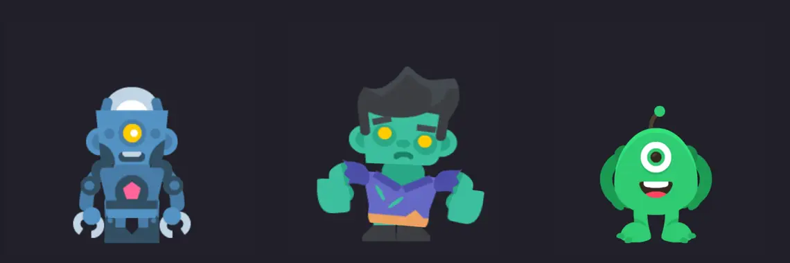

**Um kit de animação 2D por esqueleto para jogos, operado por gente e pelo Claude
Code ao mesmo tempo.** Monte um personagem a partir de um PSD em camadas, anime
numa timeline, ou peça ao Claude pelo MCP e veja cada osso que ele mexe, ao vivo,
no mesmo editor. O personagem é gravado em `.boneco`, um arquivo só e legível,
com o atlas, as transições e uma ficha escrita. Um núcleo em C++, escrito do
zero, toca esses arquivos no Godot (módulo do motor ou GDExtension) e no
navegador (456 KB de WebAssembly, 175 KB com gzip). Abre e grava projetos do Spine 4.3, então nada
do que já foi feito fica para trás, e soma o que o Spine não tem: efeitos por
parte, partículas e giro em 2,5D.

[Read in English](README.md) · Godot 4.5+ · Linux, Windows e macOS

```
466 de 466 roteiros batem com o runtime de referência em todo quadro, eventos também
20 personagens posados em 0,043 ms por quadro (nativo), cerca de 5x mais rápido que o runtime que ele substitui
102 de 102 projetos Spine 4.3 de produção vão e voltam pelo .boneco sem mudar nada
um jogo de slot em staging roda no núcleo: 1 wasm em vez de 3
objetos de GPU criados por quadro nesse jogo: 160 antes, 0,3 agora
arrastar uma chave num personagem de 8,6 s no editor: 13 ms por passo (eram 51)
```

**Nesta página:** [o que faz](#o-que-faz) · [além do Spine](#além-do-spine) · [Claude Code](#com-o-claude-code) ·
[a bancada de agentes](#a-bancada-de-agentes) · [o formato .boneco](#o-formato-boneco) ·
[o núcleo](#o-núcleo) · [use no seu jogo Godot](#use-no-seu-jogo-godot) ·
[num jogo Godot](#num-jogo-godot) · [no celular](#no-celular) · [rodar](#rodar) ·
[estado](#estado)

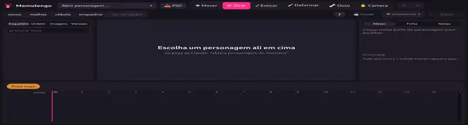

*O Claude Code montando e animando um robô a partir de peças soltas, sozinho,
pelo MCP, em 3x a velocidade. Arte: Toon Characters, de Kenney (CC0).*

Mamulengo é o boneco de mão do Nordeste, entalhado em madeira e manejado por
baixo da empanada. Este é manejado dos dois lados: um animador com o mouse e um
agente com ferramentas dividem o mesmo documento, o mesmo histórico de desfazer e
as mesmas regras do que é uma boa animação.

## O que faz

- **Do PSD ao rig.** Largue um `.psd` em camadas e ele monta o personagem na
  composição do PSD, ou atualiza o aberto camada por camada, mantendo animações,
  malhas e pesos. Entende as tags de camada de sempre (`[bone]`, `[slot]`,
  `[skin]`, `[mesh]`...), e um PSD sem tags recebe as tags, os ossos e os pivôs
  num mapa `.json` ao lado, sem regravar o arquivo.
- **Animar.** Ossos, timeline com chaves arrastáveis, editor de curvas, cebola,
  eventos, emendas entre animações vistas exatamente como o jogo toca, malhas com
  pesos pintados, pincel de deformar, IK, física, recorte, caminhos, skins.
  Movimentos prontos (respirar, balançar, quicar, entrar estourando, tremer,
  piscar, flipbook) e física pronta (cabelo, orelha, tecido, mola, pendurado).
- **Tudo é comando.** A interface e o Claude chamam o mesmo registro de comandos
  tipados, então desfazer, histórico e "ver o Claude trabalhando" saem de graça.
- **Versões e notas.** Cada gravação vira uma versão que dá para nomear, comparar
  e restaurar; qualquer um prende notas numa animação, num instante e numa parte.
- **Uma ficha por personagem.** `<nome>.ficha.md` diz o que o rig permite e o que
  cada animação deve fazer, com regras que a ferramenta confere: amplitude e
  silhueta contra a mediana da casa, limite de junta depois do IK, malha que
  dobra demais, borda escondida que aparece, emenda que pula.
- **Desenhar.** Formas vetoriais como no Figma (caneta, retângulo, elipse, furos)
  direto no personagem, desenhar sobre uma malha que cresce junto, vetorizar um PNG
  em cores chapadas e texto de qualquer fonte `.ttf` virando formas, com balões de
  fala. Guia de ilustração: [docs/DESENHAR.md](docs/DESENHAR.md).
- **Filmes curtos.** Câmera com chaves, planos e transições, texto, som preso a
  eventos e quadros ou vídeo em segundos sem abrir o editor (`tools/quadro.ts
  --gpu --video`, `tools/som.ts`). Guia: [docs/FILME.md](docs/FILME.md).
- **Exportar** GIF, WebM ou WebP animado de qualquer animação ou emenda, como está na tela ou
  num recorte fixo do mundo, com moldura para divulgar se quiser (título,
  legendas por trecho, rodapé). O GIF grava só o que muda entre quadros.
- **Imagem e vídeo de referência.** Um desenho ou a arte original por cima do personagem,
  presa ao mundo e semitransparente, para conferir pose, proporção e encaixe; ou um
  `.mp4` atrás dele, no quadro exato da timeline, para animar por cima (rotoscopia).
- **Arte mais nítida a partir do vetor.** `tools/atlas-hd.ts` refaz uma página do
  atlas em 2x, 3x... a partir do SVG original, parte por parte, no mesmo layout.

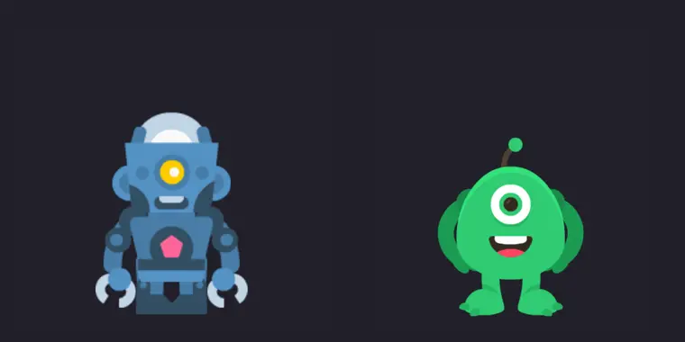

*Do ganho para o idle, visto do jeito que o jogo mistura.*

Guia completo: [docs/EDITOR.md](docs/EDITOR.md).

## Além do Spine

O que o formato `.boneco` e o núcleo fazem e o Spine não, com chaves na timeline
como qualquer outra propriedade e o mesmo desenho no editor, no navegador e no
Godot (`BonecoSprite`). A exportação para o Spine tira, com aviso.

- **Efeitos por parte:** contorno, brilho, dissolver (com tamanho do grão e borda
  em brasa) e tingir. A malha cresce pelo contorno para o halo ter onde aparecer.
- **Borrar (smear):** a parte que anda rápido estica para trás, na direção de onde
  veio, e esmaece na ponta, como os quadros de smear dos desenhos animados, e volta
  sozinha quando desacelera. Segue o que o jogo faz de verdade (mix, fila, física),
  só move vértices e quase não custa na GPU.
- **Rastro:** cópias da parte nos quadros anteriores, por trás dela e cada vez mais
  fracas, para golpes, pulos e giros; a mesma imagem e o mesmo lote, só mais geometria.
- **Luz dinâmica 2D, sem o artista pintar nada:** `tools/relevo.ts` calcula um mapa de
  normais de cada página do atlas a partir da própria arte (bordas em almofada e um
  pouco do sombreado), e luzes presas a ossos iluminam cada parte, girada, espelhada
  ou deformada por malha. Cor, força, raio e altura da luz têm chave na timeline: o
  fogo do jato ilumina as pernas por baixo e o raio acende o rosto.
- **Partículas presas a ossos:** emissores de imagens com taxa e rajadas, rampa
  de cores, soma de luz e tremor (fogo, faíscas, fumaça); **raio** procedural
  entre dois ossos; um anel em **órbita** que passa por trás e pela frente do
  corpo.
- **Geleia (jiggly):** a malha inteira mole, com massa e mola por vértice, que
  balança e chacoalha com o movimento; a moleza é por vértice e as peças presas
  seguem a geleia.
- **Blends que leem a tela:** sobrepor, luz suave, escurecer, clarear, diferença e
  subexpor, além dos quatro do Spine.
- **Camada de ajuste:** matiz, saturação, luminosidade, contraste e desfoque sobre
  tudo o que está atrás dela, com chaves na timeline (profundidade de campo, flash,
  foto revelando).
- **Giro em 2,5D:** `deform.turn` gira uma malha como um cilindro, e a cabeça olha
  para o lado com as orelhas rígidas.
- **Instâncias, um `.boneco` dentro de outro:** o que se repete fica num arquivo
  só, e a cena só posiciona as cópias e diz a cada uma o que tocar e quando, numa
  timeline de poucas chaves. O filho é lido uma vez e dividido, a instância
  escondida nem é calculada, e os filhos desenham no mesmo desenho do pai, com a
  cor e os efeitos do slot e as luzes do pai. Aninham.
- **Mosaico (mapas de ladrilhos):** uma grade de imagens do atlas presa a um slot,
  pintada no editor com pincel, borracha, retângulo e balde: vista de cima,
  isométrica (de trás para a frente, com altura por célula) ou um chão em
  perspectiva forçada pelos quatro cantos. Cada célula pode ter cor, altura, quarto
  de volta, espelho e efeitos próprios; os ladrilhos emendam sem costura. Uma fase
  inteira de `TileMapLayer` do Godot vira mosaico.
- **Pixel art perfeita:** com páginas Nearest, o editor e o vídeo exportado desenham
  na resolução da arte e ampliam sem suavizar; `query.pixel` e um aviso no editor
  apontam o que sai da grade de pixel inteiro (posição fracionária, deslocamento
  suave, giro pequeno) e `pixel.snap` conserta num passo de desfazer.
- **Palco, um jogo que o agente monta e joga:** um bloco `palco` transforma
  instâncias em atores (jogador, patrulha, coletável, porta) que colidem com um
  mosaico, simulados pelo núcleo em passos fixos e determinísticos. O agente joga
  com entrada roteirizada e mede (o pulo alcança a plataforma? o inimigo vira na
  beira?), você joga no editor com o teclado, e o MCP joga ao vivo na sua tela.
  [docs/PALCO.md](docs/PALCO.md).
- **Uma cena de interface do Godot, sem o Godot:** `src/cena` lê um `.tscn`,
  calcula os `Control` como o Godot 4 (âncoras, tamanho mínimo e máximo, direção de
  crescimento, pivô, os containers, o tamanho dos textos pelas medidas da fonte) e
  `src/tela` desenha num passo WebGL2, no tamanho exato da janela, remontando quando
  ela gira. Variantes por proporção fazem o que o esticar do Godot não faz (uma
  coluna centrada no desktop). Um jogo de produção portado assim baixa 7x menos até
  a primeira tela que o export do Godot. [docs/BACKEND.md](docs/BACKEND.md).

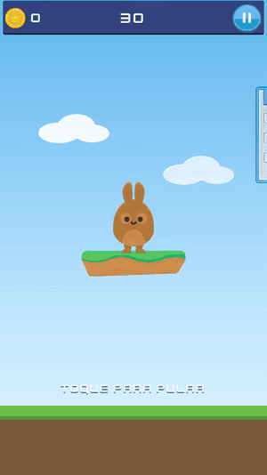

*[exemplos/coelho](exemplos/coelho): o modo de layout num joguinho (âncoras, texto
traduzido em 12 idiomas, nove-fatias e papéis), com a lógica escrita só pelo
manifesto da tela. Arte e sons da Kenney (CC0).*

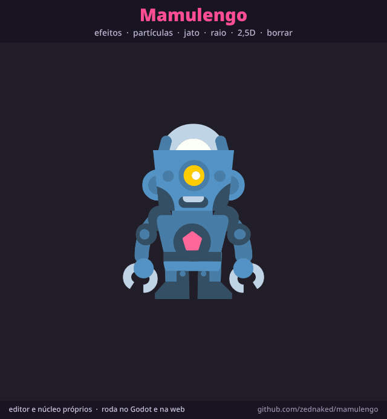

*[exemplos/vitrine](exemplos/vitrine): o robô CC0 passando por cada recurso num
laço de 8,6 s. Exportado pelo editor, com moldura e legendas.*

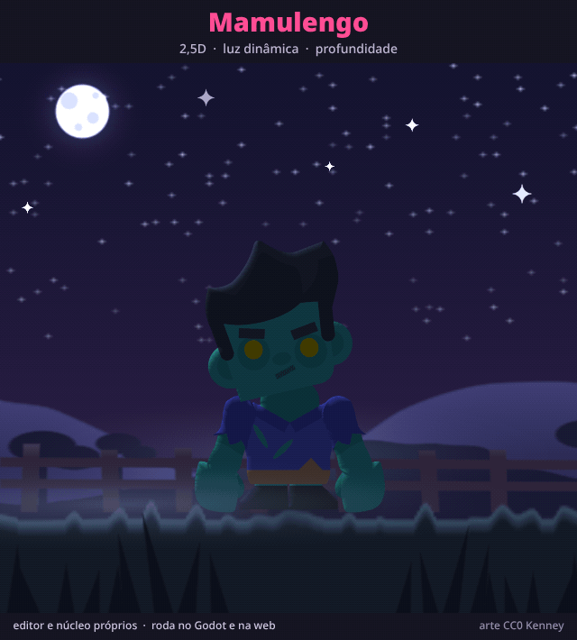

*[exemplos/vinheta](exemplos/vinheta), a abertura do topo desta página: um
espetáculo de bonecos feito de instâncias. Nove de uma letra, cinquenta lâmpadas
do letreiro, nove pessoas na plateia e a marionete do ícone, cada uma com poucas
chaves na timeline da cena; a cortina de veludo, o refletor, os feixes de pista e
a ribalta iluminam um pano de chita por camadas. Uns 32 µs de pose por quadro.*

*[exemplos/vagalume](exemplos/vagalume): 2,5D, luz e profundidade juntos. O
vagalume dá a volta no zumbi pela frente e por trás; a luz dele segue a
profundidade (rosto, lado rasante, contraluz) num relevo calculado da própria arte.*

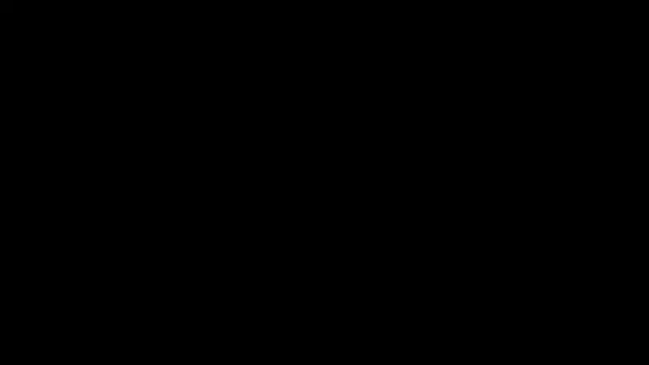

*[exemplos/abducao](exemplos/abducao): uma abdução à noite entre a abertura e o
fechamento do nome, com dois packs CC0 da Kenney. Nove camadas de paralaxe andam
pela profundidade delas (a descida da vista, o passeio da câmera e os tremores), o
disco é rigado a partir do SVG, o feixe acende o chão e curva as árvores, e o robô
sobe girando para dentro dele.*

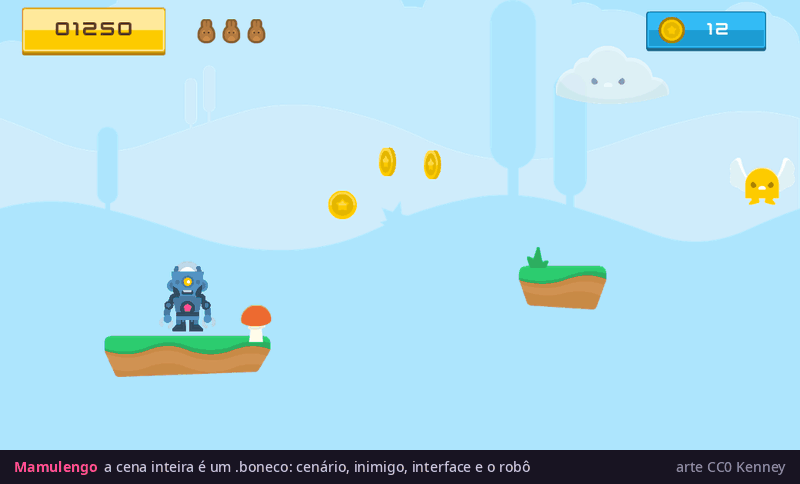

*[exemplos/jogo](exemplos/jogo): uma tela de jogo inteira num `.boneco`, com
paralaxe, plataformas, moedas, inimigo, interface e o robô como herói. Arte:
Jumper Pack, UI Pack e Particle Pack, de Kenney (CC0).*

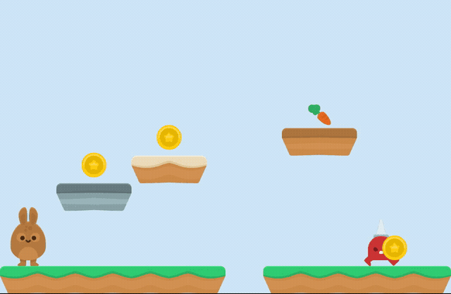

*[exemplos/palco](exemplos/palco): a primeira fase do palco, jogada pelo agente com
entrada roteirizada. Medir achou três erros de fase em segundos (o coelho batia a
cabeça embaixo da plataforma mais baixa, o buraco ficava embaixo de uma plataforma e
o pulo segurado voava por cima de duas plataformas até o inimigo). Arte: Jumper Pack
da Kenney (CC0); [exemplos/mosaico](exemplos/mosaico) tem as três formas do mosaico.*


*[exemplos/foco](exemplos/foco): a profundidade de campo como ação. Pelo visor da
câmera, o foco caça a turma, um monstro estraga a foto pulando na frente da lente,
o flash dispara e a Polaroid revela na mesa. O desfoque são camadas de ajuste.
[exemplos/vt](exemplos/vt) junta isso a [exemplos/monstros](exemplos/monstros)
(cinco monstros de geleia do Monster Builder Pack, CC0) num comercial de 26 s com
planos, câmera, texto e som.*

As contas e os parâmetros: [docs/NUCLEO.md](docs/NUCLEO.md) ("Efeitos" e
"Partículas").

## Com o Claude Code

Abra o Claude Code nesta pasta e o servidor MCP `mamulengo` está lá
(`.mcp.json`); ele sobe o editor se não estiver rodando.

| ferramenta | para quê |
|---|---|
| `mamulengo_open`, `mamulengo_assets` | achar e abrir um personagem |
| `mamulengo_run` | comandos em lote, um passo de desfazer, tudo ou nada |
| `mamulengo_look` | um quadro ou folha de contato, sozinha ou numa emenda |
| `mamulengo_guia` | o fluxo: ficha, rigar, animar, conferir |
| `mamulengo_notas`, `mamulengo_versoes` | notas da equipe e versões |
| `mamulengo_export` | GIF ou WebM, devolve o caminho do arquivo |
| `mamulengo_psd` | personagem novo a partir de um PSD, ou o aberto atualizado |

Para trabalhar numa janela que alguém está olhando, `tools/ponte.ts servir` mantém
uma conexão fixa com o editor aberto e repassa chamadas (`chamar`, `olhar`), e cada
passo aparece lá na hora.

Enquanto um agente trabalha, qualquer outra aba do editor o acompanha: o
personagem, a animação e os ossos que ele toca acendem conforme ele avança, e o
que ele escreve entre os comandos aparece como legenda.

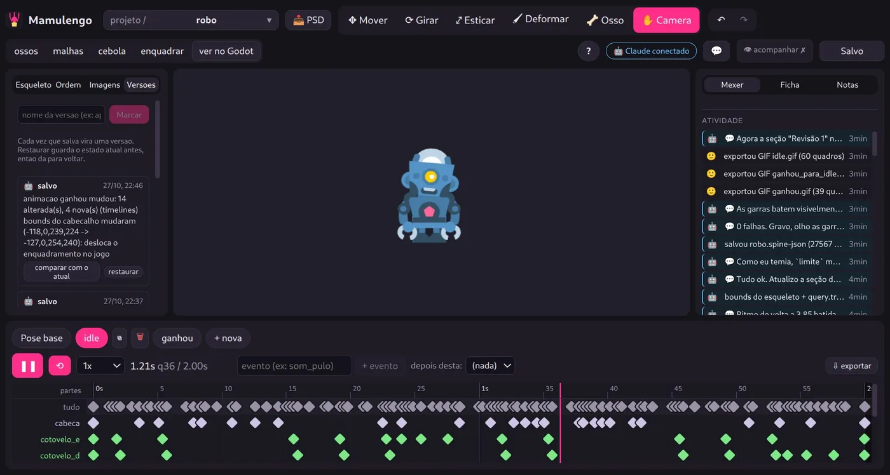

*O editor enquanto o Claude trabalha: cada gravação vira uma versão (à esquerda), cada
comando e nota do agente aparece na atividade (à direita).*

O que o `mamulengo_look` devolve é o que o agente usa para julgar, uma folha de contato
com as poses-chave:

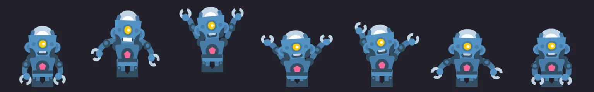

## A bancada de agentes

Um Claude Code sem interface recebe um pedido escrito e faz o rig, a ficha e as
animações só pelo MCP, numa pasta isolada. Um agente diretor dá nota pela
rubrica e devolve com observações. A tela pode ser gravada, e é daí que vêm
estes timelapses.

| robô: `ganhou` | zumbi: `anda` | monstro: `ganhou` |
|---|---|---|
| 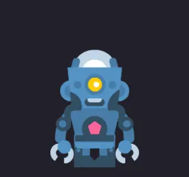 | 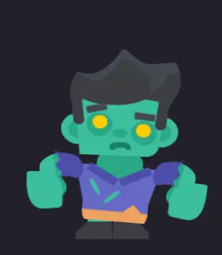 | 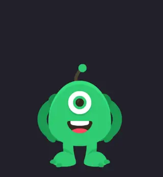 |

<details>
<summary>Os outros dois timelapses: o zumbi e o monstro</summary>

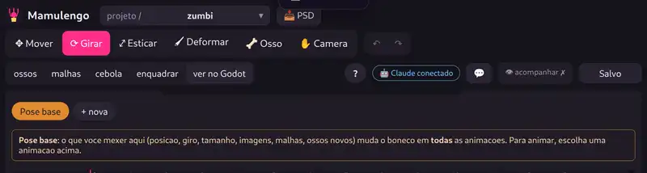

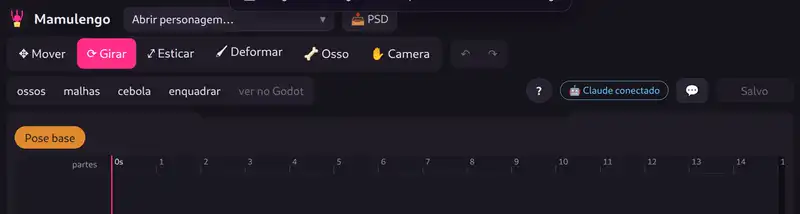

</details>

Arte: [Toon Characters](https://kenney.nl/assets/toon-characters-1) e
[Monster Builder Pack](https://kenney.nl/assets/monster-builder-pack), de Kenney
(CC0). Rigs, fichas e animações feitos pelo agente. Guia:
[docs/BANCADA.md](docs/BANCADA.md).

## O formato .boneco

Um JSON por personagem: esqueleto, regiões do atlas, animações, os tempos de
emenda que o jogo usa, a compressão das páginas no jogo e a ficha. Os campos são
em português e cada um tem ida e volta com o Spine 4.3, então um `.boneco`
exporta de volta exatamente o JSON e o atlas de onde veio (102 de 102 projetos de
produção, com mediana de 1,05x o tamanho). Onde os dois runtimes que os jogos
usavam discordavam (multiply ignorando o alfa, gravidade da física com sinal
trocado), o formato diz qual vale. Para entregar ao jogo, o mesmo arquivo pode ir
em binário: cerca de 5 vezes menor e 1,6 vez mais rápido de carregar, com a pose
igual byte a byte. Especificação: [docs/FORMATO.md](docs/FORMATO.md).

```sh
npx tsx tools/boneco.ts importar <x-data.tres|x.json> <x.boneco>
npx tsx tools/boneco.ts exportar <x.boneco> <pasta>
```

## O núcleo

`nucleo/` é C++17 sem dependências, escrito em sala limpa: a partir de uma
especificação escrita e de números medidos num runtime de referência usado como
caixa-preta, nunca do código dele. Faz pose (ossos, curvas, slots, regiões,
malhas com pesos, deformar, IK, transformação, caminho e física), estado de
animação (trilhas, fila, mix, eventos) e lista de desenho (lotes por página e
blend, recorte no stencil da GPU ou na CPU).

| medido contra o runtime de referência | resultado |
|---|---|
| pose, 78 animações de 20 personagens, todo quadro a 30 fps | pior osso a 0,00005 px |
| estado de animação, 466 roteiros (tocar, enfileirar, cortar, vazio, mix 0 e 0,2) | todo quadro a menos de 0,0005 px, mesmos eventos no mesmo quadro |
| desenho no navegador, 20 personagens lado a lado | só nas bordas, de 0 a 1,1% dos pixels |
| velocidade, 20 personagens | 0,043 ms por quadro, nativo |

A especificação, e o que foi preciso descobrir para bater (pi em float32, bezier
amostrada em 9 pontos, um passo de física zero no primeiro quadro):
[docs/NUCLEO.md](docs/NUCLEO.md). O `palco.html` toca qualquer `.boneco` pelo
núcleo ao lado da referência, com a diferença pixel a pixel.

## Use no seu jogo Godot

Baixe o `mamulengo-boneco-<versão>.zip` da
[última release](../../releases/latest) (ou pegue o "Boneco" na Asset Library
do Godot) e copie a pasta `addons/boneco` dele para o seu projeto. Godot 4.5 ou
mais novo, no Linux x86_64, Windows x86_64 e macOS (universal). Depois:

```gdscript
var sprite := BonecoSprite.new()
sprite.data = BonecoData.carregar("res://heroi/heroi.boneco")
add_child(sprite); sprite.set_animation("idle", true, 0)
```

Mix, fila, trilhas e os sinais (eventos também):
[addons/boneco/README.md](addons/boneco/README.md) (em inglês). Um projeto com
três personagens CC0, um clique que troca a animação e os eventos na tela:
[exemplos/godot-boneco](exemplos/godot-boneco).

## Num jogo Godot

`nucleo/godot` compila o mesmo código de dois jeitos:

- **módulo do motor**, dentro de um template de exportação web: um wasm só, sem
  carregar GDExtension no navegador;
- **GDExtension** (Linux, Windows e macOS) para o editor, o F5 e o CI headless com o
  Godot oficial.

O `BonecoSprite` guarda uma malha por lote e só regrava os vértices a cada
quadro. Num jogo de slot com 17 personagens animados, em staging, o módulo do motor
substituiu o plugin oficial: um wasm em vez de três, export de 51 MB em vez de 64
MB, primeiro quadro em 3,4 s em vez de 6,7 s. Esses tempos foram medidos com uma
versão anterior do módulo; o do núcleo sai com o mesmo wasm de 38,6 MB e o mesmo
download comprimido, e no nativo agora custa menos por quadro (0,54 ms para os 17
personagens, contra 0,63 ms). No navegador, com os dois a 120 fps, ele ocupa cerca
de 3 pontos a mais da thread principal que aquela versão (eram 6 a 8 antes de um
perfil do desenho e do recorte), e com a CPU 4x mais lenta os quadros acima de
25 ms empatam. Guardar as malhas levou os objetos de GPU criados por quadro de 160
para 0,3, e peça parada não envia nada. De 153 quadros comparados pixel a pixel com o renderizador
anterior, 142 são iguais; os outros 11 vêm de flipbooks um passo adiante (4 acima
de 1% dos pixels, 7 abaixo de 0,5%), e onde foi conferido, é o núcleo que bate com
a referência.

```sh
nucleo/godot/compilar.sh linux    # GDExtension (também windows, macos), como o CI faz
nucleo/godot/montar-addon.sh out  # o zip do addon, a partir de nucleo/godot/bin
scons platform=web target=template_release threads=no custom_modules=<repo>/nucleo/godot  # template web, no código do Godot
```

## No celular

Medido num Android intermediário (Galaxy A52s, Chrome, tela 1080 x 2177 a 60 Hz) com
um jogo web do Godot 4 feito em 700 x 1370: os quadros que ele perde não vêm da
animação. O núcleo e o plugin oficial do Spine perdem os mesmos quadros, e 35% da
thread principal fica esperando a GPU. A exportação web do Godot dimensiona o canvas
pela densidade de pixels da tela (2,81 ali), então o jogo de 700 px é desenhado com
1080 px de largura, mais que o dobro de pixels, sem arte para mostrar.

| canvas (29/10, densidade emulada) | quadros acima de 25 ms em 30 s | p95 | thread principal |
|---|---|---|---|
| densidade da tela, 1080 x 2112 | 183 / 125 / 127 | 32,6 ms | 87 a 93% |
| **tamanho base, 720 x 1408** | **10 / 9 / 13** | **16,4 ms** | **64 a 65%** |

No dia seguinte, depois de uma atualização do Chrome do celular, o mesmo jogo rodou liso
mesmo na densidade da tela (15 quadros acima de 25 ms em 30 s), e a correção, já dentro do
export de verdade, deu de 10 a 15 e uns 3 pontos a menos de thread principal. O ganho depende
do aparelho e do navegador: o tamanho base nunca custa nada visível (a captura fica igual) e
tira a GPU do caminho quando ela é o gargalo. A correção é um script
no **Head Include** do preset web (Exportar > Web > HTML), sem mudar o motor nem o
template; ponha nos dois números o tamanho base do seu projeto:

```html
<script>
// desenha o canvas no maximo no tamanho base do jogo: numa tela densa, o resto e so custo de GPU
(() => {
  const LARGURA = 700, ALTURA = 1370; // window/size/viewport_width e viewport_height
  const nativo = window.devicePixelRatio || 1;
  Object.defineProperty(window, "devicePixelRatio", {
    configurable: true,
    get: () => Math.min(nativo, Math.max(1, LARGURA / innerWidth, ALTURA / innerHeight)),
  });
})();
</script>
```

Como foi medido, e o `tools/medir-web.ts` para medir o seu jogo num celular pelo
`adb`: [docs/CELULAR.md](docs/CELULAR.md).

## Rodar

No modo de desenho "núcleo" o editor não usa o `spine-core`: o desenho, a pose, a interação, as
medidas, a ficha e os comandos vêm do núcleo em wasm. Todo personagem abre no "núcleo", `.boneco` ou
projeto do Spine. Os modos "godot" e "spine", que ficam para comparar com o runtime antigo
dos jogos e com o editor do Spine, e o oráculo dos testes usam o `spine-core` e o `spine-webgl` (instalados pelo npm),
que exigem uma [licença do Spine](https://esotericsoftware.com/spine-purchase). O núcleo em
`nucleo/` e o formato `.boneco` não dependem deles.

```sh
npm install
echo "MAMULENGO_ROOTS=/caminho/dos/projetos" > .env.local
npm run dev                                   # http://localhost:5199
npm test                                      # todos os comandos, sem assets externos
cmake -S nucleo -B nucleo/build -G Ninja && cmake --build nucleo/build
npx tsx tools/nucleo-compara.ts tests/boneco tests/nucleo  # o núcleo contra a referência
```

**O editor pelo navegador**, sem servidor (o mesmo do link no topo):

```sh
npm run build:navegador                       # dist-navegador/, site estático
npm run preview:navegador                     # http://localhost:5214/
```

Um service worker faz o papel do servidor: lê e grava `.boneco` numa pasta do computador
(Chrome e Edge, em "Abrir personagem…") ou na pasta própria do navegador, onde ficam os
exemplos. Faz o mesmo que o editor instalado, projetos Godot, PSD, relevo, versão leve, arte HD,
efeitos e trocar imagens inclusive, e importa e baixa `.zip` para o Firefox e o Safari. Só comparar
com o Godot de verdade precisa do `npm run dev`.

**O Claude no editor pelo navegador:** suba a ponte e abra o editor com `?ponte=` no endereço
(fica lembrado; `?ponte=0` desliga). O MCP liga nela como no `npm run dev`. Ela só aceita
páginas do Mamulengo (a própria máquina e o GitHub Pages); se o Chrome perguntar pelo acesso à
rede local, permita.

```sh
npx tsx tools/ponte-servidor.ts 5199
# e abra https://zednaked.github.io/mamulengo/editor/?ponte=5199
```

Detalhes: [docs/EDITOR.md](docs/EDITOR.md) ("Pelo navegador").

`tests/assets` tem três personagens CC0 de Kenney (cartoon, mascote, humano), montados
só com comandos do Mamulengo; `tests/boneco` tem esses três mais o robô, o zumbi e o
monstro que a bancada de agentes fez, seis ao todo (o elenco da demo ao vivo). Testes de paridade e as
diferenças de motor que o editor reproduz: [docs/PARIDADE.md](docs/PARIDADE.md).

## Estado

Funcionando: o editor (desenho, pose e medidas pelo núcleo no modo "núcleo"), o
servidor MCP, a bancada de agentes, o `.boneco` com efeitos e partículas, o
núcleo com o módulo e a GDExtension do Godot. Um jogo de slot roda em staging com
o módulo do motor, e a versão `.boneco` dele, toda no núcleo, passa nos testes.
O núcleo é o modo padrão do editor para todo projeto, o `.boneco` binário está
pronto e o editor abre por um link, sem instalar. Um primeiro jogo web de
produção roda inteiro no runtime do Mamulengo, com as telas geradas do projeto do
Godot no deploy; num perfil de celular médio ele fica pronto umas nove vezes
antes que o export do Godot.

**Modo de layout (telas sem Godot):** uma tela é um `.boneco` montado no editor.
Os ossos se prendem à janela (cantos, bordas, centro, esticar), as partes de
texto têm chave de tradução nos 12 idiomas (direita para a esquerda e devanágari
inclusive), as imagens podem ter nove-fatias e os ossos ganham papéis (botão com
os estados normal, em cima, apertado e desligado, área de toque, texto trocado
pelo código). Um PSD em camadas já chega proposto como tela
([docs/LAYOUT-PSD.md](docs/LAYOUT-PSD.md)). A tela grava um manifesto, e a lógica
do jogo é escrita sobre ele pelos nomes (`tela.botao("jogar").aoTocar(...)`): veja
[exemplos/coelho](exemplos/coelho). Próximos: cópias em tempo de jogo (listas),
mover um osso pelo código, âncora com margem fixa e um primeiro jogo de produção
convertido por esse caminho. Plano: [docs/ROADMAP.md](docs/ROADMAP.md).

## Licença

MIT, ver [LICENSE](LICENSE). A arte CC0 em `tests/` e as bibliotecas do Spine que o
editor instala do npm seguem as licenças delas (listadas no [NOTICE](NOTICE)).
