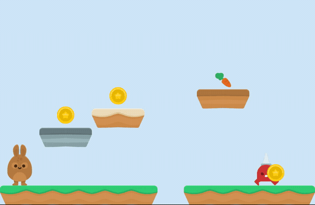

# Palco: o jogo feito pelo MCP

Um runtime de jogo experimental dentro do Mamulengo (proposta em docs/ROADMAP.md, seção 8): a fase
mora no `.boneco`, a simulação no núcleo (C++, wasm e nativo) e o agente monta, joga e mede sem uma
pessoa no meio. O Godot continua o alvo de produção; o palco é para protótipo, demonstração e jogo
pequeno na web.

## O que é cada coisa

- **A cena** é um `.boneco` comum: o mapa é um mosaico (docs/NUCLEO.md, "Mosaico") e cada personagem
  ou objeto é uma instância (outro `.boneco`, com as animações dele), presa a um osso.
- **O palco** é o bloco `palco` (`stage` no JSON do editor) que diz quem é quem:

| campo | o quê |
|---|---|
| `gravidade` | px/s² para baixo (padrão 900) |
| `solido` | `{mosaico, paleta}`: os ladrilhos do mosaico que seguram (paleta: os nomes das imagens sólidas; sem ela, todas) |
| `pixel` | desenha os atores em pixel inteiro (a simulação segue fracionária) |
| `atores` | a lista: `nome`, `instancia` (padrão: o nome), `tipo`, `caixa` [largura, altura] com o meio de baixo nos pés, `velocidade`, `pulo`, `lado` (1 direita, -1 esquerda) e `animacoes` {parado, andando, pulo, morto} (nomes das animações do filho; padrão: os próprios) |

Tipos (`type` no editor → `tipo` no `.boneco`): `player` → `jogador`, `patrol` → `patrulha`,
`collectible` → `coletavel`, `door` → `porta`, `prop` → `enfeite`.

## Montar por comandos

O agente monta a fase inteira pelo MCP (`mamulengo_run`), sem gerador:

- **o mapa:** `mosaic.set` (a grade e a paleta) e `mosaic.paint` (pincel, retângulo, balde);
- **o palco:** `stage.set {gravity, solid: {mosaic, palette?}, pixel?}`;
- **cada ator:** `stage.actor {name, boneco, x, y, type, box, speed, jump, side, animations}`. Com
  `boneco`, cria de uma vez o osso (os pés em x, y), a camada e a instância; sem ele, faz ator de
  uma instância que já existe (e x, y movem o osso dela);
- **tirar:** `stage.remove {name, delete?}` (com delete, apaga instância, camada e osso) e
  `stage.delete`. Renomear ou apagar a instância leva o ator junto.

`tools/nucleo-palco.ts` confere isso: parte do mapa sem nenhum ator, põe os seis só com
`stage.set` e `stage.actor`, e a mesma rota vence igual, quadro a quadro.

## As regras (passo de 1/60 s)

- **Entrada:** bits por passo (1 esquerda, 2 direita, 4 pulo). O pulo vale na borda (apertar) e só no chão.
- **Jogador:** anda na velocidade, pula com `pulo` px/s, cai pela gravidade.
- **Patrulha:** anda no lado dela e vira na parede ou na beira (sem chão logo à frente).
- **Colisão:** caixa contra os ladrilhos sólidos, um eixo de cada vez (x, depois y); caindo e batendo, está no chão.
- **Jogador com os outros:** coletável some e soma um ponto; porta vence; patrulha: caindo com os pés na metade de cima dela é pisão (ela some e o jogador quica), senão o jogador morre. Cair abaixo do mapa mata.
- **No esqueleto:** a posição e o lado vão para o osso da instância (o pai sem giro nem escala); a animação dela muda pelo estado (parado, andando, pulo, morto); quem sai de cena tem a camada apagada.
- **Determinístico:** a mesma entrada dá o mesmo jogo, quadro a quadro, no node, no editor e no vídeo.

## Jogar e medir

- **Pela linha de comando:** `npx tsx tools/palco.ts x.boneco --roteiro "direita+pulo 50, pulo 2, direita 20, nada 40"` mostra onde o jogador está no fim de cada trecho, os pontos, se venceu ou morreu (`--json` para o estado inteiro). Roteiro: trechos `teclas quadros` (teclas: esquerda, direita, pulo, com +, ou nada; 60 quadros por segundo; cada trecho com pulo aperta de novo).
- **Filmar:** `npx tsx tools/quadro.ts x.boneco --palco "roteiro" --video vence.mp4 --rect ...` (o roteiro e mais 1 s); com `--seguir`, o `--rect` só dá o tamanho e a câmera acompanha o jogador (macia, a cada passo do jogo, sem sair da caixa do esqueleto).
- **No editor:** com o palco, o botão "🎮 jogar" no alto da tela: setas ou A/D andam, espaço, W ou ↑ pulam, R recomeça, Esc sai; o placar mostra as moedas e o fim. Quando a fase não cabe na tela, a câmera acompanha o jogador.
- **Exportar:** `npx tsx tools/exportar-jogo.ts x.boneco jogo.html [--titulo "nome"] [--fundo cfe8f7] [--vista 1280,720]` gera uma página HTML só (cerca de 750 KB na fase de exemplo) com o núcleo em wasm, os `.boneco`, os filhos e as páginas dentro, e o tocador (`src/jogo/jogo.ts`): teclado, botões de toque no celular, câmera que acompanha o jogador, placar e recomeçar. Abre direto do disco ou de qualquer hospedagem estática. A fase de exemplo fica no GitHub Pages em `/jogo/`.
- **Pelo MCP:** `mamulengo_play {roteiro, aoVivo}` joga no editor da pessoa (ao vivo, em tempo real; ou de uma vez) e devolve o estado no fim de cada trecho; `{parar: true}` sai.
- **No Godot:** o `BonecoSprite` joga o mesmo palco (`stage_start`, `set_stage_input`, `stage_step`, `get_stage_state`; docs/NUCLEO.md, "No Godot"). A rota que vence dá o mesmo jogo que o núcleo web, quadro a quadro.
- **Conferência:** `tools/nucleo-palco.ts` joga a fase de exemplo: a rota que vence, a mesma entrada dando o mesmo jogo, cair no buraco, o pisão, encostar no inimigo e a patrulha virando nas beiras.

## O que medir revelou na primeira fase

A fase de exemplo foi acertada pelas medidas, não de olho: o coelho (180 px) batia a cabeça na
plataforma mais baixa, o buraco embaixo de uma plataforma impedia de pular o buraco, e segurando
"direita" o pulo passava por cima de duas plataformas e caía no inimigo. Cada um apareceu no
`tools/palco.ts` em segundos.

## Falta

- montar a fase pelo editor (hoje: por comandos ou pelo gerador): inspetor do ator, caixa na tela;
- regras "quando X, então Y", estados com mais animações (golpe, dor), som pelos eventos;
- paralaxe no fundo; ladrilho de uma via (subir por baixo);
