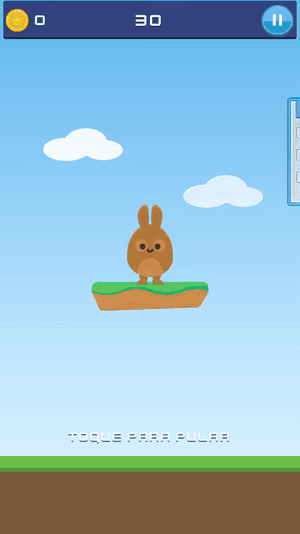
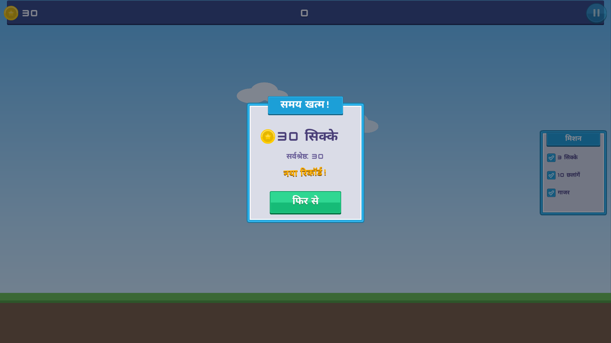
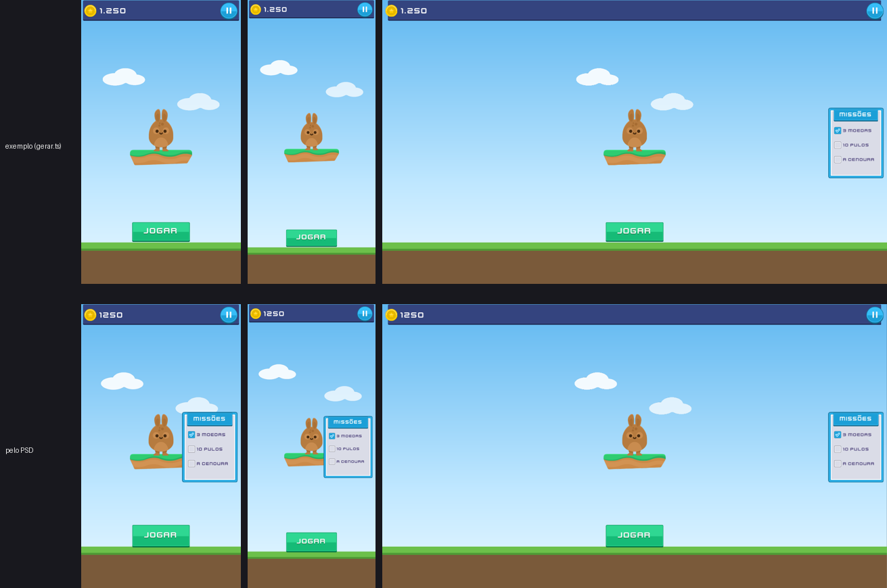

# The bunny: a small game made with the layout mode

[Português](README.pt-BR.md)



[The whole round on video (WebM)](coelho.webm)

A 30-second game built only in Mamulengo, without Godot: the bunny stands on its island and jumps to
catch the coins floating by (low ones while standing, high ones only mid-jump), a carrot worth 5, and
dodges the spike balls (they take 2 coins). The missions in the panel check themselves off, the pause
freezes the game, and at the end come the result, the best score (kept in the browser) and "again". In
12 languages, on a phone held upright, a tablet and a desktop.

It is the showcase of the **layout mode** (docs/ROADMAP.md, section 10): **anchors** (each group
pinned to a point of the window), **translated text** (Godot's translation table, Arabic and Devanagari
shaped right), **nine-slice** (the bar, the panels and the buttons that grow with their text) and
**roles** (what each element is to the code: button, touch area, text set by code). And it shows the
whole path: **a finished screen + its manifest → the game**. Whoever wrote the logic never opened the
editor.

## Play

    npm run dev        # then open http://localhost:5199/exemplos/coelho/jogo/

Tap the screen (or Space) to jump; P or Esc pauses; Enter starts. `?idioma=ar` (or `en`, `es`, `hi`,
`ru`, `fr`, `it`, `ne`, `fil`, `de`, `nl`), `?semente=7` (always the same round), `?mudo` (muted).
`/exemplos/coelho/` is the screen alone, idle on the menu.

## In a few steps

1. **Open it in the editor.** `npm run dev`, open `http://localhost:5199/` and pick `coelho-jogo`
   from the character list (the in-browser editor ships it among its examples). Each group of the
   screen is a bone: `heroi` (the island and the bunny), `placar` (score), `pausa`, `painel`, `fim`...
2. **Play the screen.** "▶ jogar a tela": hover the JOGAR (play) button, press, release; the pause and
   "de novo" (again) too. Each button state (normal, hover, pressed, disabled) is an animation.
3. **Change an anchor.** Pick the `painel` bone and its anchor in the inspector (it is pinned to the
   middle of the right edge). At the top of the viewport switch the window (phone, tablet, desktop) or
   see them all side by side: the score stays in its corner, the bar stretches edge to edge, the bunny
   stays centered.
4. **Switch the language and a text.** The viewport's language picker swaps every text (JOGAR in German,
   SPIELEN, widens the button; Arabic letters join). The language table shows each key in each
   language and flags what overflows its box. The texts come from `translations.csv` (Godot's format).
5. **Read the manifest.** `coelho-jogo.manifesto.json` (the `query.roles` command) lists what the code
   can call: the buttons (`jogar`, `pausa`, `denovo`), the `pular` (jump) touch area (the whole
   screen), the texts set by code (`placar`, `tempo`, `aviso`, `resultado`, `recorde`), the texts with
   parameters (`{n} moedas`), the states (animations), the events and the languages.
6. **See the logic find everything by name.** [`jogo/jogo.ts`](jogo/jogo.ts), about 280 commented
   lines (in Portuguese, like the names on the screen):

```ts
const tela = await TelaBoneco.abrir(gl, N, desenhista, "../coelho-jogo.boneco");
tela.ligarPonteiro(canvas);                              // mouse and finger -> buttons and touches
tela.botao("jogar").aoTocar(comecar);                    // the "jogar" role from the manifest
tela.aoApertar("pular", pular);                          // the "pular" touch area: jump on press
tela.estado("coelho/pula", { trilha: 2, depois: "coelho/respira" });
if (tela.distancia("corpo", "moeda1") < 70) pegar();     // caught the coin (in base-art units)
tela.texto("placar", "12");  tela.texto("resultado", { n: 12 });   // in the screen's language
tela.ritmo(trilhasDoJogo, 0);                            // pause: the game stops, the buttons don't
tela.aoEvento("moeda", () => som.play());                // sound from the animation events
```

## How it is made

- **`gerar.ts`** builds the screen: it writes `coelho-jogo.boneco`, the image page (`coelho-jogo.png`)
  and the manifest, through the same commands as the editor and the MCP (`screen.set`, `anchor.set`,
  `text.set`, `slice.set`, `role.set`). Changed the screen? `npx tsx exemplos/coelho/gerar.ts`.
- **Anchors:** the sky and the dimmer stretch both ways; the grass and the top bar, in width; the score
  in the top-left corner, the pause in the top-right; the timer and the mission toast at the top; the
  bunny and the result in the center; JOGAR at the bottom; the panel at the middle of the right edge.
- **States** are animations: the bunny breathes, jumps (crouches, stretches, hangs at the top, squashes
  on landing and settles), gets hurt and celebrates; the coin spins through Kenney's frames; the sparkle
  on a catch; the missions checking off; the toast; the pause; the end. The logic picks each one's track
  (the list is at the top of `jogo/jogo.ts`).
- **Repeated things** (6 coins, 2 spike balls) are pre-built on the screen and turned on and off by the
  animations: Mamulengo does not create copies at runtime yet (docs/ROADMAP.md, section 10, "o
  joguinho do coelho", with the list of what the API does not do yet).

## The proof

    npx tsx tools/tela-jogo-teste.ts           # whole rounds in a headless Chromium (70 checks)
    npx tsx tools/tela-jogo-teste.ts --video   # and records coelho.webm and coelho.gif

The test plays with a fixed seed and the clock in hand (`?manual`), clicking with a real mouse: the
JOGAR states, start, jump, catching a coin, the mission checked with its toast, the pause that freezes,
the end with the result and the best score, "again"; in Portuguese and Arabic on a phone, Portuguese
and Hindi on a desktop. Screenshots in `capturas/jogo/`.



## From a PSD

The menu screen also exists drawn in layers, the way a designer would hand it over
(`tests/assets/psd/tela.psd`, written by `tools/psd-tela-fixture.ts` with the same art), and imported as a
screen with no map, only by the naming convention (docs/LAYOUT-PSD.md): `psd/tela.boneco`. The proposal
gets the menu's 9 anchors right, JOGAR with its states from the `normal`, `apertado` and `desligado`
layers, the pause, the score as a code text (`txt_placar`), the 6 texts in Kenney Future with their table
keys, and the nine-slices of the bar, the panel, the title and the button. `capturas/psd/` compares it
with the generator's screen from before the game.



    npx tsx tools/psd-tela-fixture.ts        # writes tests/assets/psd/tela.psd
    npx tsx exemplos/coelho/psd/importar.ts  # imports it as a screen into psd/
    npm run dev                              # then open /exemplos/coelho/ver/ (any screen: ?boneco=<url>)

## Licenses

- Art: [Kenney](https://kenney.nl), CC0 (UI Pack, Jumper Pack and the Kenney Future font;
  [`kenney/License.txt`](kenney/License.txt)). The sky, grass, clouds, sparkle stars and pause icons
  are drawn by `gerar.ts`.
- Sounds: Kenney Digital Audio and Music Jingles, CC0 ([`sons/License.txt`](sons/License.txt)).
- Fallback fonts: Noto Sans Arabic and Noto Sans Devanagari, SIL OFL 1.1
  ([`fontes/OFL.txt`](fontes/OFL.txt)).
- The code, like the rest of Mamulengo: MIT.
