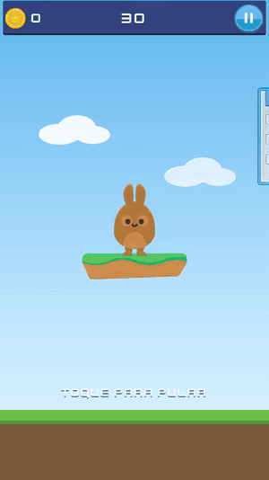
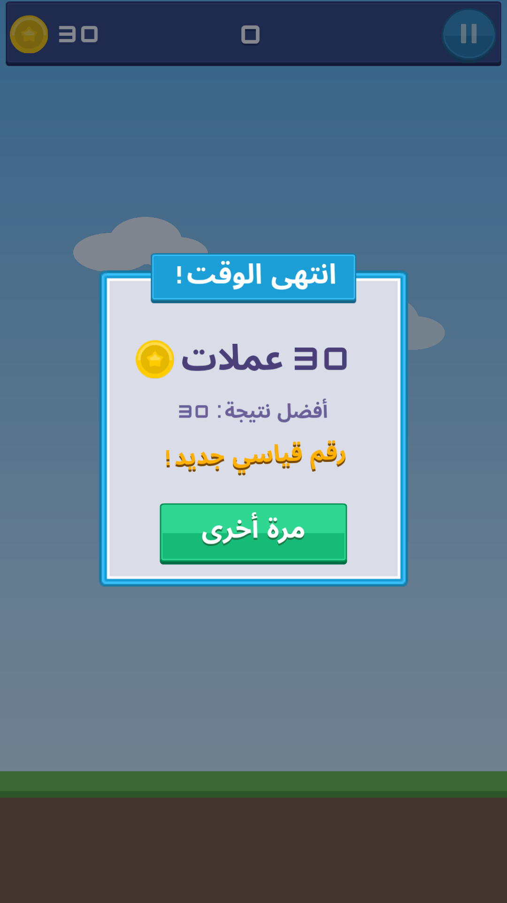
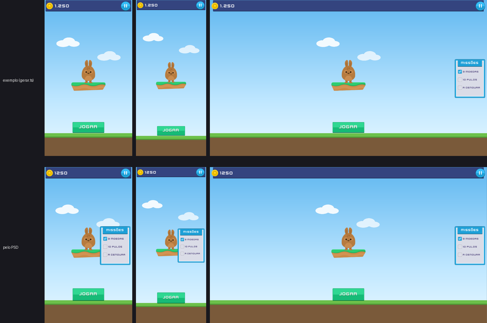

# O coelho: um joguinho feito com o modo de layout

[English](README.md)



[A rodada inteira em vídeo (WebM)](coelho.webm)

Um jogo de 30 segundos montado só no Mamulengo, sem Godot: o coelho fica na ilha e pula para pegar
as moedas que passam flutuando (as de baixo ele pega parado, as do alto só no pulo), uma cenoura que
vale 5 e foge dos espinhos (que levam 2 moedas). As missões do painel marcam sozinhas, a pausa congela
o jogo, e no fim aparecem o resultado, o recorde (guardado no navegador) e "de novo". Em 12 idiomas,
no celular em pé, no tablet e no desktop.

É a vitrine do **modo de layout** (docs/ROADMAP.md, seção 10): **âncoras** (cada grupo preso a um
ponto da janela), **texto com tradução** (a tabela de idiomas do Godot, árabe e devanágari certos),
**nove-fatias** (a barra, os painéis e os botões que crescem com o texto) e **papéis** (o que cada
elemento é para o código: botão, área de toque, texto do código). E mostra o caminho inteiro:
**a tela pronta + o manifesto → o jogo**. Quem escreveu a lógica não abriu o editor.

## Jogar

    npm run dev        # e abra http://localhost:5199/exemplos/coelho/jogo/

Toque na tela (ou espaço) para pular; P ou Esc pausa; Enter começa. `?idioma=ar` (ou `en`, `es`, `hi`,
`ru`, `fr`, `it`, `ne`, `fil`, `de`, `nl`), `?semente=7` (a mesma rodada sempre), `?mudo`.
`/exemplos/coelho/` é a tela sozinha, parada no menu.

## Em poucos passos

1. **Abra no editor.** `npm run dev`, abra `http://localhost:5199/` e escolha `coelho-jogo` na lista
   de personagens (no editor pelo navegador ele vem entre os exemplos). Cada grupo da tela é um osso:
   `heroi` (a ilha e o coelho), `placar`, `pausa`, `painel`, `fim`...
2. **Jogue a tela.** "▶ jogar a tela": o mouse passa por cima do JOGAR, aperta, solta; a pausa e o
   "de novo" também. Cada estado do botão (normal, em cima, apertado, desligado) é uma animação.
3. **Mude uma âncora.** Escolha o osso `painel` e, no inspetor, a âncora (ele está preso ao meio da
   direita). No alto do viewport, troque a janela (celular, tablet, desktop) ou veja todas "lado a
   lado": o placar fica no canto, a barra estica de ponta a ponta, o coelho fica no centro.
4. **Troque o idioma e um texto.** O seletor de idioma do viewport troca todos os textos (o JOGAR em
   alemão, SPIELEN, alarga o botão; em árabe as letras se ligam). A tabela de idiomas mostra cada chave
   em cada língua e marca o que estoura a caixa. Os textos do jogo saem de `translations.csv` (o
   formato do Godot).
5. **Leia o manifesto.** `coelho-jogo.manifesto.json` (o comando `query.roles`) lista o que o código
   pode chamar: os botões (`jogar`, `pausa`, `denovo`), o toque `pular` (a tela inteira), os textos
   do código (`placar`, `tempo`, `aviso`, `resultado`, `recorde`), os textos com parâmetros
   (`{n} moedas`), os estados (as animações), os eventos e os idiomas.
6. **Veja a lógica achar tudo pelo nome.** [`jogo/jogo.ts`](jogo/jogo.ts), umas 280 linhas comentadas:

```ts
const tela = await TelaBoneco.abrir(gl, N, desenhista, "../coelho-jogo.boneco");
tela.ligarPonteiro(canvas);                              // mouse e dedo -> botões e toques
tela.botao("jogar").aoTocar(comecar);                    // o papel "jogar" do manifesto
tela.aoApertar("pular", pular);                          // o toque "pular": pula ao apertar
tela.estado("coelho/pula", { trilha: 2, depois: "coelho/respira" });
if (tela.distancia("corpo", "moeda1") < 70) pegar();     // pegou a moeda (na arte base)
tela.texto("placar", "12");  tela.texto("resultado", { n: 12 });   // no idioma da tela
tela.ritmo(trilhasDoJogo, 0);                            // a pausa: o jogo para, os botões não
tela.aoEvento("moeda", () => som.play());                // o som pelos eventos das animações
```

## Como é feito

- **`gerar.ts`** é quem monta a tela: escreve `coelho-jogo.boneco`, a página de imagens
  (`coelho-jogo.png`) e o manifesto, pelos mesmos comandos do editor e do MCP (`screen.set`,
  `anchor.set`, `text.set`, `slice.set`, `role.set`). Mudou a tela? `npx tsx exemplos/coelho/gerar.ts`.
- **As âncoras:** o céu e o escuro esticam nos dois eixos; a grama e a barra do topo, na largura; o
  placar no canto de cima e da esquerda, a pausa no da direita; o tempo e o aviso em cima; o coelho e
  o resultado no centro; o JOGAR embaixo; o painel no meio da direita.
- **Os estados** são animações: o coelho respira, pula (agacha, estica, segura no alto, amassa no
  pouso e assenta), se machuca e comemora; a moeda gira pelos quadros da Kenney; o brilho de pegar; as
  missões marcando; o aviso; a pausa; o fim. A lógica escolhe a trilha de cada um (a lista está no
  começo de `jogo/jogo.ts`).
- **O que se repete** (6 moedas, 2 espinhos) vai pré-montado na tela e é ligado e desligado pelas
  animações: o Mamulengo ainda não cria cópias em tempo de jogo (docs/ROADMAP.md, seção 10, "o
  joguinho do coelho", com a lista do que a API ainda não faz).

## A prova

    npx tsx tools/tela-jogo-teste.ts           # rodadas inteiras num Chromium sem tela (70 conferências)
    npx tsx tools/tela-jogo-teste.ts --video   # e grava coelho.webm e coelho.gif

O teste joga com semente fixa e o relógio na mão (`?manual`), clicando com o mouse de verdade: os
estados do JOGAR, começar, pular, pegar moeda, a missão marcada com o aviso, a pausa que congela, o fim
com o resultado e o recorde, "de novo"; em português e árabe num celular, em português e hindi num
desktop. Capturas em `capturas/jogo/`.



## Pelo PSD

A tela do menu também existe desenhada em camadas, como um designer entregaria (`tests/assets/psd/tela.psd`,
gerado por `tools/psd-tela-fixture.ts` com a mesma arte), e importada como tela sem mapa, só pela
convenção de nomes (docs/LAYOUT-PSD.md): `psd/tela.boneco`. A proposta acerta as 9 âncoras do menu, o
JOGAR com os estados pelas camadas `normal`, `apertado` e `desligado` (o `em_cima`, que o PSD não tem, é a
pose padrão), a pausa com as poses padrão, o placar como texto do código (`txt_placar`), os 6 textos com a
fonte Kenney Future e as chaves da tabela, e as nove-fatias da barra, do painel, do título e do botão. As
capturas em `capturas/psd/` comparam com a tela do gerador de antes do jogo.



    npx tsx tools/psd-tela-fixture.ts        # escreve tests/assets/psd/tela.psd
    npx tsx exemplos/coelho/psd/importar.ts  # importa como tela em psd/
    npm run dev                              # e abra /exemplos/coelho/ver/ (qualquer tela: ?boneco=<url>)

## Capturas

- `capturas/jogo/`: o jogo rolando (`*-jogando`, `*-pulando`, `*-missao`), a pausa, o fim e o menu, em
  `celular-pt`, `celular-ar`, `desktop-pt` e `desktop-hi`; `estados-jogar.png` (os 4 estados do JOGAR,
  ampliados).
- `capturas/`: a tela parada no menu em cinco janelas (`celular-9x16`, `celular-9x20`, `tablet-3x4`,
  `desktop-16x9`, `desktop-21x9`, e `tres-tamanhos.png`); `capturas/textos/` e `capturas/fatias/`, a
  mesma tela em vários idiomas. Refazer (com o Vite numa porta própria):

      MAMULENGO_PORT=5289 npx vite &
      npx tsx tools/tela-capturas.ts "http://localhost:5289/exemplos/coelho/?quadro=1.5" exemplos/coelho/capturas \
        celular-9x16=1080x1920 celular-9x20=1080x2400 tablet-3x4=1536x2048 desktop-16x9=1920x1080 desktop-21x9=2560x1080

- As do editor (`editor-*.png` em `capturas/`, `capturas/textos/`, `capturas/fatias/` e
  `capturas/papeis/`) são da tela de antes do jogo (o placar, o JOGAR e as missões já estavam lá): o
  inspetor da âncora, do texto, da nove-fatias e do papel, a tabela de idiomas e "jogar a tela".

## Licenças

- Arte: [Kenney](https://kenney.nl), CC0 (UI Pack, Jumper Pack e a fonte Kenney Future;
  [`kenney/License.txt`](kenney/License.txt)). O céu, a grama, as nuvens, as estrelas do brilho e os
  ícones da pausa são desenhados pelo `gerar.ts`.
- Sons: Kenney Digital Audio e Music Jingles, CC0 ([`sons/License.txt`](sons/License.txt)).
- Fontes de reserva: Noto Sans Arabic e Noto Sans Devanagari, SIL OFL 1.1
  ([`fontes/OFL.txt`](fontes/OFL.txt)).
- O código, como o resto do Mamulengo: MIT.
