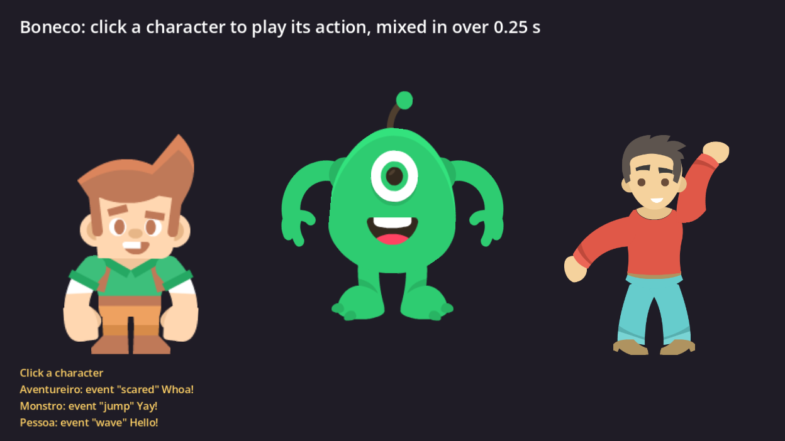

# Boneco example (Godot 4.5+)

Three CC0 characters playing `idle`. Click one to play its action, mixed in over
0.25 s and queued back to `idle`; the events keyed in the actions show up at the
bottom of the window.

## Run

1. Download `mamulengo-boneco-<version>.zip` from the releases page and copy its
   `addons/` folder here, so that `addons/boneco/boneco.gdextension` exists.
2. Open `project.godot` in Godot 4.5 or newer and press F5.

Headless check, as the CI runs it: `godot --headless --path . --import`, then
`godot --headless --path . -- --teste` (prints `boneco exemplo: ok`).
`-- --foto=shot.png`, with a window, also saves a screenshot mid action.

## Files

- `main.tscn`, `main.gd`: the scene and the click, mix and event code.
- `personagens/`: the characters from `tests/boneco` with one event added to
  each action, made by `preparar.py`. Art: Kenney (kenney.nl), CC0 1.0; each
  folder keeps the original `License.txt`.
