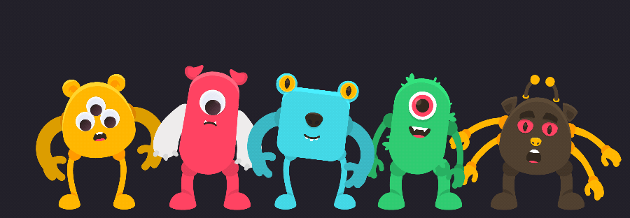

# The monsters: jiggly bodies

`monstros.boneco` is the five monsters from the sample image of Kenney's Monster Builder Pack
(CC0), assembled piece by piece (body, arms, legs, eyes, mouth, ears, horns, antennae) and rigged
by the generator, in one looping animation (`cena`, 10 s):

| time | what happens |
|---|---|
| 0.0 to 0.6 s | they all breathe and sway to a beat, each at its own phase; blinks spread over the whole loop |
| 0.6 to 2.8 s | the blue one waves; the others turn their faces to it |
| 2.8 to 4.6 s | the red one crouches, jumps and lands hard; the yellow one, next to it, gets a fright |
| 4.6 to 6.6 s | the green one laughs (eyes shut, tongue out, slapping its legs); the brown one gets angry: brows down, four arms flailing, two stomps |
| 6.6 to 8.8 s | a wave runs from left to right, and they all hop together at the end |
| 8.8 to 10.0 s | everything settles into the opening pose |

**The jiggle** is the core's jelly (docs/NUCLEO.md "Geleia") on every body, plus its rotation
physics on forearms, ears, horns and antennae:

- the body is a fine mesh (`mesh.create` at detail 4, 194 to 396 points) with jelly: a stiff
  spring and little damping, so it shakes three to four times a second after each jolt and rings
  a few times before settling. Only the very bottom edge is held (the legs stay attached); the
  softness rises quickly from there (`curve` 0.4 to 0.5). Eyes, mouth, nose, brows, arms and
  details follow the jelly; the legs do not (the feet stay on the ground);
- what makes it shake is the beat: every 0.625 s each body takes a sharp step to the side, a
  quick twist and a squash ("boing"), each monster at a different point of the beat. Slow,
  smooth motion barely moves a jelly body; sharp jolts do;
- the amplitude is set by the softness of each point (here half of the automatic one) and by the
  physics `mix` (0.5); the physics has a speed `limit` (200 px/s) so the take-off of a jump does
  not flip horns upside down;
- each monster has its own jelly: yellow and brown in between, red and blue firmer, green the
  softest and sagging a little.

**Effects** come from the effects library (`biblioteca/efeitos`), the same way the editor's
"+ efeito…" adds them: ground dust when the red one lands, at the brown one's stomps and at every
landing of the wave, and a green cloud from the laughing green one, each as bursts on the
timeline, with the texture variants picked per particle. The yellow and the red ones' eyes, which already
looked like a doll's, are googly eyes (`eye.googly` at the same spot and size): their pupils hang, roll and
shake with every jolt.

**The rig:** legs are meshes on two bones with IK to a target on the ground (`dobra_positiva`
follows the bend already in the drawing); thin legs use a grid mesh and weights by height (thigh
above, shin and the whole foot below the knee), since the automatic outline cut into a thin leg.
Arms are meshes on two bones, behind the body as Kenney drew them; when an arm has the body's
color it is a shade darker so it reads against the belly. Each monster is drawn as one block, the
middle ones in front of the outer ones.

Generated by `npx tsx exemplos/monstros/gerar.ts` (the choreography is in `cena.ts`). The pieces
are the pack's 2x PNGs in `fontes/` (with its `License.txt`); in the world each piece has the size
of the 1x PNG. The GIF is the editor's export of a fixed crop of the world
(`"rect": [-750, -25, 1500, 520]`, 20 fps, 900 px wide).
