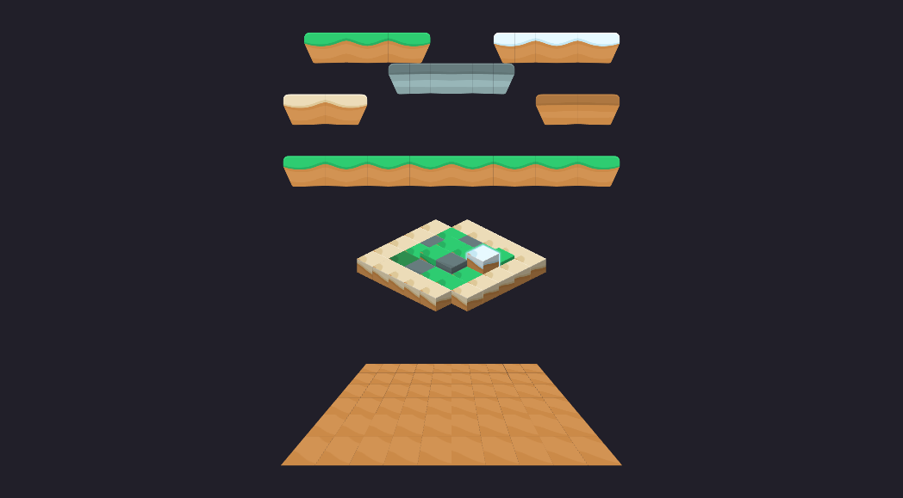

# Mosaico

Three maps made of tiles from Kenney's Jumper Pack (CC0, in `kenney/` with its `License.txt`), one
for each shape of the mosaic (docs/NUCLEO.md, "Mosaico"):

- **platforms** (grid): the left end and the piece next to it become two tiles; the right end is
  the left one mirrored and the middle alternates the per-cell mirror, so every edge meets the
  same edge of its neighbour and the platforms tile without seams;
- **island** (iso): diamond blocks built from the same textures (the top is the grass, sand or
  stone band of the ground, the sides its profile, darker), with per-cell height, colour and glow;
  the `flutua` animation moves the island's bone;
- **floor** (grid with forced perspective): a checkerboard of dirt and sand seen at an angle, from
  the four corners of the grid.

    npx tsx exemplos/mosaico/gerar.ts

Open `mosaico.boneco` in the editor, select a layer and press "🖌️ pintar" to paint.
