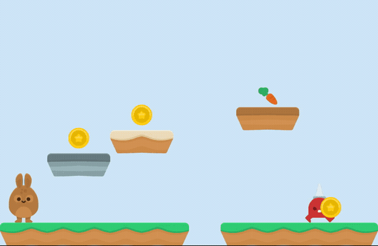

# Palco: a first level made with the MCP

A one-screen platformer using Kenney's Jumper Pack (CC0, in `kenney/`, plus the grounds from
[the mosaic example](../mosaico)): the bunny (player), the spike (patrol), three coins
(collectibles) and the carrot (the exit), on a mosaic map. Each character is a frame-swap
`.boneco`; `palco.boneco` places them as instances and its `palco` block says who is who
(docs/PALCO.md).

    npx tsx exemplos/palco/gerar.ts
    npx tsx tools/palco.ts exemplos/palco/palco.boneco --roteiro "direita+pulo 50, pulo 2, direita 20, nada 40, direita 30, direita+pulo 50, direita 30"
    npx tsx tools/nucleo-palco.ts

Open `palco.boneco` in the editor and press "🎮 jogar" (arrows or A/D, space to jump, R restarts).
The level was tuned by measuring it with `tools/palco.ts`, not by eye.
