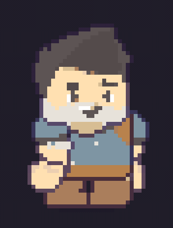
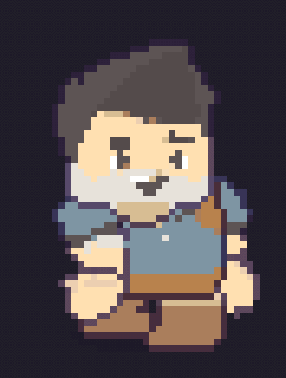
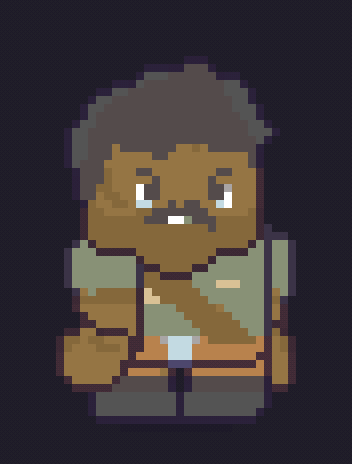
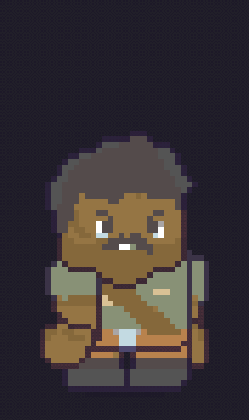

# Pixel art with bones

The adventurer and the soldier from Kenney's **Platformer Characters 1** (CC0, in `kenney/` with
its `License.txt`), turned into pixel art and rigged by `gerar.ts`.

| | | | |
|---|---|---|---|
|  |  |  |  |

The conversion, piece by piece: a short palette taken from the opaque pixels of the original art
(16 colors per character, which drops the anti-aliasing blends), half resolution keeping the
**most frequent color** of each 2x2 block (an average turns eyes into smudges on flat-color art),
hard edges and a 1 px darker outline. The pieces were placed by matching them against the pack's
"stand" pose; the arms hang straight in the setup so a still piece lands on the pixel grid, and turn
in the animations: `parado`, `andando`, `acenando`, `pulo`.

The pages use the `Nearest` filter and 1 texture pixel per world unit, so the editor turns on
**pixel perfect** by itself (the "pixel" button under "ver"): the character is drawn at the art's own
resolution and enlarged without smoothing, like a pixel-art game, so positions and rotations stay on
the pixel grid. GIF/WebM export uses it too.

```sh
npx tsx exemplos/pixel/gerar.ts
```
