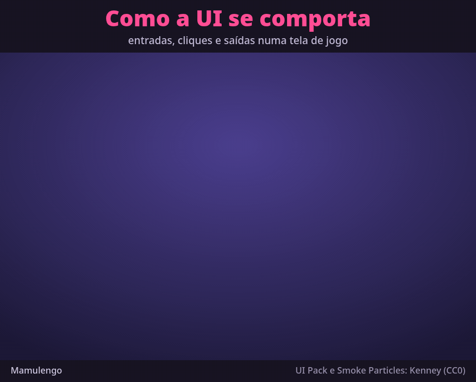

# The UI: how a game screen behaves

`ui.boneco` is a UI case made with Kenney's UI Pack (CC0): three screens of a generic game, played
by a cursor doing what a player would, in one looping animation (`ui`, 11.6 s). The video
(`ui.webm`, and the GIF) carries a caption for each rule:

| time | screen | the rule shown |
|---|---|---|
| 0.0 to 1.5 s | main menu | entrance: the panel grows a little past its size and settles; the title drops in and the buttons rise one after the other |
| 1.5 to 2.6 s | main menu | hover: the button grows 6% in 0.12 s; click: it swaps to the pressed art and moves down 4 px; on release, a small bounce |
| 2.6 to 3.1 s | main menu | exit: faster than the entrance, in reverse order |
| 3.1 to 4.0 s | options | screen change: the new panel slides in from the right and settles |
| 4.0 to 4.9 s | options | toggle: the check mark pops in |
| 4.9 to 6.0 s | options | drag: the handle grows while held and the bar follows the cursor |
| 6.0 to 7.05 s | options | back: the panel leaves the way it came |
| 7.05 to 8.9 s | reward | the background dims, the popup pops and the stars come in one by one, each with a flash |
| 8.9 to 10.3 s | reward | call to action: the button pulses until it is tapped |
| 10.3 to 11.6 s | reward | close: an anticipation, and the popup vanishes in a puff |

Each element is a bone with its pieces; the generator writes its pose as a function of time
(position, scale, rotation, transparency of the group and of the piece, and the image swap for the
pressed buttons and the check box), sampled at 30 fps. The flash and the puff come from the effects
library (`biblioteca/efeitos`).

Generated by `npx tsx exemplos/ui/gerar.ts`. The pack's pieces are in `fontes/` (2x PNGs, the
Kenney Future font and the `License.txt`); the texts are set in that font, and the panels, the
background and the cursor are drawn by the generator. The GIF and the WebM are the editor's export
of `"rect": [-480, -350, 960, 620]` (the bottom 80 px are the caption band) with the frame in
`moldura.json`.
