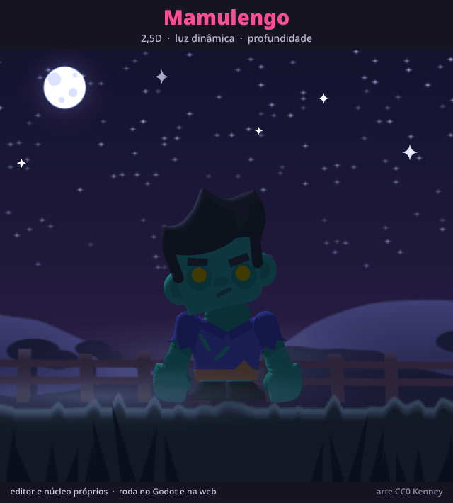

# The firefly: 2.5D, light and depth

`vagalume.boneco` is the CC0 zombie from `tests/boneco/zumbi` on a night with a firefly, made to
show 2.5D turns, dynamic light and depth together, in one looping animation (`vagalume`, 8 s):

| time | what happens |
|---|---|
| 0.0 to 1.3 s | the zombie dozes standing up (half-closed eyes, head drooping); only the moon, behind him, rims his outline |
| 0.9 to 2.0 s | the firefly arrives on the right, in front: that side of the face lights up, he wakes up and his head **turns in 2.5D** after the light |
| 2.0 to 3.6 s | the firefly circles **behind** him: it is drawn behind the body, its light turns into a **rim light**, and his head and body turn the other way to follow it |
| 3.6 to 4.7 s | it comes back low in front; he tries to catch it with both hands, claps and misses, and looks up as it escapes |
| 4.7 to 6.4 s | it lands on his nose: a start of surprise, then the face lit up close |
| 6.4 to 8.0 s | it flies off up to the left and he dozes off again |

The depth cues: the firefly grows as it comes forward and switches sides in the draw order (a slot
behind everything and one in front); the height of its light follows the depth (in front it lights
the face, at the side it grazes, behind it becomes a rim light); the shadow on the ground slides
away from the light; and the fog drifts in two layers, the front one faster.

The light is the core's (docs/NUCLEO.md "Luzes"): a normal map built from the art itself by
`tools/relevo.ts` (`zumbi-hd_relevo.png`), a low blue ambient, the moon as a rim light and the
firefly's light tied to its bone. The head (all three faces) and the body are meshes turned with
`deform.turn`, keyed by the generator through the same commands the editor uses.

Generated by `npx tsx exemplos/vagalume/gerar.ts`. The zombie page at 3x comes from the pack's
vector file (`Zombie/Vector/character_zombie.svg`) by
`npx tsx tools/atlas-hd.ts tests/boneco/zumbi/zumbi.boneco character_zombie.svg --id "{nome}_0_Layer0_*_FILL" --saida exemplos/vagalume/zumbi-hd.webp`,
and its normal map by `npx tsx tools/relevo.ts exemplos/vagalume/vagalume.boneco --borda 24 --paginas 0`.
The sky, ground, moon, fog, shadow and firefly images are drawn by the generator. The GIF is the
editor's export of a fixed crop of the world (`"rect": [-210, -75, 420, 400]`) with a frame and
captions. Art: Toon Characters 1 by Kenney, CC0.
