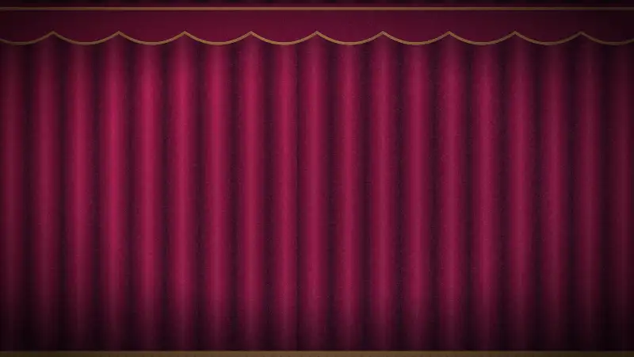

# The opening: a puppet show made of instances

An 8-second opening for Mamulengo, built in Mamulengo. A mamulengo is a puppet theatre, so the
opening is a show: curtain, spotlight, marquee, audience. `vinheta.boneco` is the stage; what
moves on it lives in small files it places as **instances** and tells what to play and when
(docs/NUCLEO.md "Instâncias").

| file | what it is | instances |
|---|---|---|
| `marionete.boneco` | the string puppet from the icon: three control rods, strings to the shoulders, head and body. `chega` (drops onto its strings and bounces), `danca` (with a head bob), `pula`, `eletrico` (lightning down the strings, stars around the head) and `reverencia` (the bow) | 1 |
| `letra.boneco` | one letter (a skin per letter of the name) with a pink extrusion in three layers: `chega` (comes from the viewer, hits the screen, lets out a ring), `onda`, `brilha`, `flutua` and `sai` | 9 |
| `lampada.boneco` | a marquee bulb that blinks; offset in time, the light runs around the name | 50 |
| `plateia.boneco` | a person in the audience, in silhouette: `balanca`, and `vibra` (arms up) when the puppet bows, switched with a mix | 9 |

| time | what happens |
|---|---|
| 0 to 0.75 s | the curtain opens, the spotlight flickers on, the puppet comes out of the distance |
| 0.7 to 1.65 s | it lands on its strings and bounces; confetti in stars, streamers and dots |
| 1.0 to 2.3 s | the letters come from the viewer and hit the screen one by one; the marquee lights up |
| 1.65 to 3.45 s | the puppet dances; pink and cyan disco beams sweep the stage and light it |
| 3.4 to 4.25 s | a wave runs through the letters and the puppet jumps, yanked by its strings |
| 4.25 to 5.25 s | lightning down the strings, stars orbiting the head, everything lit blue |
| 4.75 to 6.0 s | the bar grows, the subtitle dissolves in, a glow runs across the name, the letters float |
| 6.15 to 7.15 s | the bow: the audience jumps and streamers, stars and notes rain from the top |
| 7.0 to 8.0 s | the letters fly at the viewer and the curtain closes; the loop starts closed |

The light comes in layers (docs/NUCLEO.md "Luzes"): slots and lights have a depth, so the
spotlight lights the stage from the front, a cold rim light sits deep behind it, the footlights
light from below and the chita backdrop, far back, shows its flowers only where the light gets.
The velvet folds, the puppet, the letters and the flowers have normal maps built from the art
(`tools/relevo.ts`; the puppet with `--camadas`, so a piece in front keeps its outline).

The finishing is done in the scene too, as layers over everything: a warm grade (a multiply
layer) with the blacks lifted a touch (a screen layer), light leaks crossing the frame when the
curtain opens and at the bow, flashes on the landing and with the lightning, film grain that moves
every film frame (24 a second) and a lens vignette. Two adjustment layers (docs/NUCLEO.md
"Ajuste") work on what is already drawn: one pulls the stage into focus as the curtain opens
(a blur that goes from 9 px to 0), the other turns the frame cold and contrasty with each
lightning strike and saturates it at the bow. The WebP above is exported by the editor
itself (`export` with `format: "webp"`), with no other tool.

The scene has 69 instances and costs about 32 µs of pose and 25 µs of drawing a frame in the
core. Each letter is four keys on the scene's timeline, each bulb one; the motion lives once in
the child files. Generated by `npx tsx exemplos/vinheta/gerar.ts`, which draws every image (SVG
through sharp, the name in Noto Sans) and writes all five files and the normal maps.
